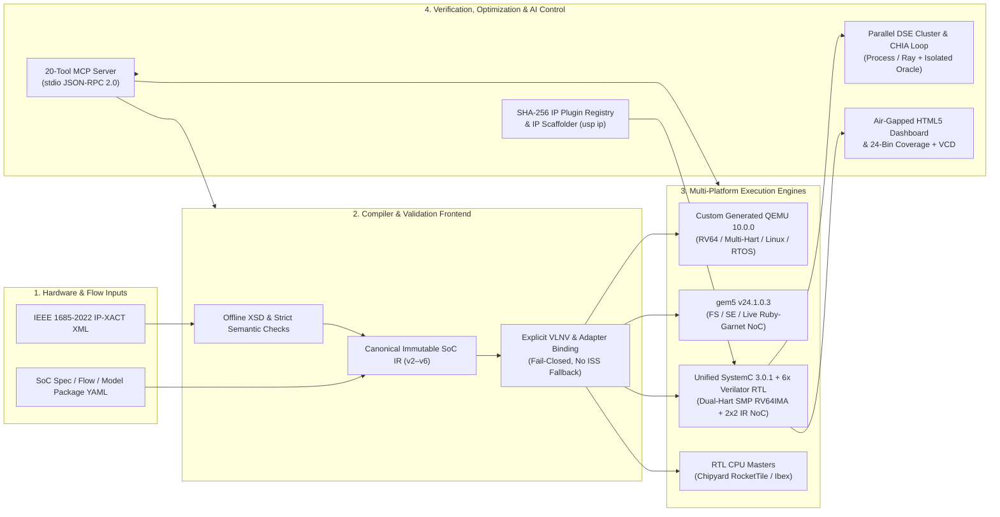

# IP-XACT RISC-V Virtual Platform (`socsim-platform` / `usp`)

| Metadata Field | Value |
|---|---|
| **Project Version** | `0.3.0a5` (SDK Image `0.3.0a5-r1`) |
| **Standards** | IEEE 1685-2022 (IP-XACT), IEEE 1666 (SystemC 3.0.1 / TLM-2.0), IEEE 1364 (VCD), MCP JSON-RPC 2.0 |
| **Primary CLI** | `usp` (alias: `socsim`) |
| **Governance & Rules** | [`agent.md`](agent.md) · [`docs/roadmap.md`](docs/roadmap.md) · [`docs/verification-status.md`](docs/verification-status.md) |

An industrial, headless **IP-XACT → Canonical SoC IR → Multi-Platform HW/SW Emulator & Verification Platform** for RISC-V SoCs. It compiles validated IEEE 1685-2022 hardware descriptions and typed SoC specifications into deterministic simulation targets spanning **QEMU**, **gem5 (SE / FS / Ruby-Garnet NoC)**, **SystemC 3.0.1 / TLM-2.0**, **Verilator 5.032 SystemVerilog RTL**, and **bare-metal / FreeRTOS / Zephyr / µC/OS / OpenSBI+Linux** software stacks—with zero silent ISS substitution and SHA-256 tamper-evident run bundles.

---

## Architecture Overview



---

## Quickstart

### Option A: Rootless Podman SDK (Recommended — Zero Host Pollution)

Pre-packages Python 3.12.14, QEMU 10.0.13, RISC-V bare-metal & Linux GCC toolchains, SystemC 3.0.1, Verilator 5.032, Yosys 0.52, and OpenJDK 21 in an isolated rootless OCI container:

```bash
bash scripts/podman.sh build               # Build from committed HEAD (git archive)
bash scripts/podman.sh smoke               # Offline (--network=none) full native + 6x RTL + MCP smoke
bash scripts/podman.sh qa full             # Run full QA/QC scorecard inside Podman
bash scripts/podman.sh run                 # Open interactive SDK shell in /workspace
```

Or using Podman Compose ([`containers/compose.yaml`](containers/compose.yaml)):

```bash
mkdir -p .podman/{build,tools,results,venv,cache}
podman compose -f containers/compose.yaml run --rm unified-soc
```

### Option B: Native Linux Python Virtual Environment (`uv` or `pip` + `requirements*.txt`)

```bash
# 1. Create & verify .venv (auto-selects uv sync --frozen or python3 -m venv + requirements-all.txt)
bash scripts/setup_venv.sh --extra all --verify
source .venv/bin/activate

# Or explicitly via standard pip + pinned requirements files:
bash scripts/setup_venv.sh --method pip --extra all --verify

# 2. Audit host & pinned multi-platform toolchains (non-destructive)
bash scripts/setup_all.sh --check

# 3. Fetch pinned upstream sources (QEMU v10.0.0, gem5 v24.1.0.3, Chipyard 1.13.0, OpenTitan)
bash scripts/setup_all.sh --all --fetch-only

# 4. Run full local quality gate via Makefile
make check
```

See [`docs/setup-and-environment.md`](docs/setup-and-environment.md) for per-platform build flags (`setup_qemu.sh`, `setup_gem5.sh`, `setup_chipyard.sh`, `setup_opentitan.sh`).

---

## Multi-Platform IP & Simulator Traceability Matrix

| Platform / Subsystem | Pinned Upstream / Origin | Setup Script | Execution Engine & Actual Binding |
|---|---|---|---|
| **QEMU RISC-V** | `qemu/qemu` `v10.0.0` (`7c949c53e936`) | [`scripts/setup_qemu.sh`](scripts/setup_qemu.sh) | Custom generated `usp-rv64` machine (bare-metal, Zephyr, FreeRTOS, OpenSBI+Linux) + Debian 10.0.13 `virt` smoke |
| **gem5 & Garnet NoC** | `gem5/gem5` `v24.1.0.3` (`b9da2bfe1e21`) | [`scripts/setup_gem5.sh`](scripts/setup_gem5.sh) | Native FS/SE + Live Ruby/MI_example/Garnet mesh + out-of-tree MMIO/PLIC/DMA bridges (`USE_SYSTEMC=0`) |
| **Chipyard / Chisel** | `ucb-bar/chipyard` `1.13.0` (`69eba860a352`) | [`scripts/setup_chipyard.sh`](scripts/setup_chipyard.sh) | Source-built `RocketTile` AXI CPU, Chipyard Ibex RTL master, Chisel/CIRCT GCD core (`sbt 1.10.7`, `firtool 1.62.0`) |
| **OpenTitan RTL** | `lowRISC/opentitan` `earlgrey_silver_release_v5` (`ed044fc9760b`) | [`scripts/setup_opentitan.sh`](scripts/setup_opentitan.sh) | Verilated upstream `gpio.sv` / `tlul_pkg.sv` / `prim_fifo_sync.sv` over SystemC 3.0.1 bridge |
| **Unified SystemC + 6× Verilator RTL SoC** | Original clean-room RTL + SystemC 3.0.1 (`specs/multiplatform/unified_systemc/`) | Bundled in SDK (`Containerfile`) | Single `sc_main` binary: Dual-Hart SMP `RV64IMA_Zicsr` + IR-generated 2×2 NoC + 6× Verilator 5.032 RTL IPs (`MAC NPU`, `SHA-256`, `AES-128`, `SPI`, `I2C`, `L2 Cache`) + DMA + IOPMP + GDB RSP + VCD + 24-bin coverage |

---

## Repository Structure

```text
.
├── Containerfile                 # Digest-pinned multi-stage OCI SDK (uv 0.13.5 + Debian trixie)
├── Makefile                      # Standard industrial targets (venv, setup-*, check, podman-*)
├── pyproject.toml / uv.lock      # Canonical Python package & frozen dependency lockfile
├── requirements*.txt             # Pinned pip requirements (base, dev, models, bringup, all)
├── containers/                   # OCI entrypoint, proxy trust secret hook, offline smoke, compose.yaml
├── docs/                         # Industrial engineering documentation (Diataxis hub: docs/README.md)
├── examples/                     # Validated reference IP-XACT & QEMU/Zephyr/FreeRTOS/SystemC SoCs
├── models/                       # Versioned hardware model catalog & SystemC bridge templates
├── native/ & platforms/          # Native backend boards & platform configuration profiles
├── scripts/                      # Modular setup_*, bring-up, CI lint, regression & Podman scripts
├── skills/                       # Agent operational setup & update playbooks
├── specs/                        # Native SoC YAML specs, IP-XACT 2022, flows & unified multi-platform SoC
├── src/socsim/                   # Python compiler, IR, backends, unified emulator, DSE, CHIA loop, MCP server
├── systems/                      # Sanitized AI_SOC / AIZ_SOC inventories and executable bring-up profiles
├── tests/                        # 610+ automated unit, contract, container, MCP & integration tests
└── upgrade/                      # Approved M1–M9 milestone ledger & enterprise roadmap audit specs
```

---

## Core CLI & AI MCP Commands

```bash
# 1. Native IP-XACT / SoC compiler & validation
usp validate examples/rv64-ips
usp soc generate specs/AI_SOC-native.yaml --engine both --out build/ai-soc

# 2. Single Unified Multi-Platform SystemC/TLM-2.0 + 6x Verilator RTL SoC
usp unified-soc run specs/multiplatform/unified_hetero_soc.yaml --out results/unified-soc
usp unified-soc calibrate specs/multiplatform/unified_hetero_soc.yaml --out results/unified-cal

# 3. CHIA-Style Parallel DSE Sweep, Cyclic Optimization Loop & HTML5 Dashboard
usp dse sweep specs/multiplatform/unified_hetero_soc.yaml --out results/dse --workers 2 --cluster process --cache results/dse-cache
usp loop run specs/multiplatform/unified_hetero_soc.yaml --out results/chia-loop --max-iters 4 --cache results/loop-cache
usp dashboard generate --out results/dashboard.html \
  --unified results/unified-soc/report.json \
  --calibration results/unified-cal/calibration.json \
  --dse results/dse/dse-report.json \
  --loop results/chia-loop/loop-report.json

# 4. IP Plugin Scaffolder & SHA-256 Versioned Registry
usp ip scaffold xor_accel --out results/xor_accel
usp registry publish results/xor_accel/package.yaml --registry results/reg --version 1.0.0
usp registry verify --registry results/reg

# 5. Model Context Protocol (MCP) 20-Tool Server for AI Coding Agents
usp mcp tools --root .
usp mcp config --client podman --root .
bash scripts/podman.sh mcp
```

---

## Documentation Hub

All documentation is organized under the **Diataxis** taxonomy in [`docs/README.md`](docs/README.md):

- **Onboarding & Environment:** [`docs/setup-and-environment.md`](docs/setup-and-environment.md) · [`docs/podman.md`](docs/podman.md) · [`docs/build-reproducibility.md`](docs/build-reproducibility.md)
- **Architecture & Internals:** [`docs/architecture.md`](docs/architecture.md) · [`src/README.md`](src/README.md) · [`docs/canonical-native-ir.md`](docs/canonical-native-ir.md) · [`docs/unified-systemc-soc.md`](docs/unified-systemc-soc.md) · [`examples/ASoC`](examples/ASoC/README.md) (Official 20-IP / 2-Cluster / NPU + LPU + PMP Example)
- **AI & Automation Interfaces:** [`docs/mcp-server.md`](docs/mcp-server.md) · [`scripts/README.md`](scripts/README.md) · [`containers/README.md`](containers/README.md)
- **Verification & Governance:** [`docs/verification-status.md`](docs/verification-status.md) · [`docs/industrial-readiness.md`](docs/industrial-readiness.md) · [`docs/roadmap.md`](docs/roadmap.md) · [`upgrade/enterprise-emulator-roadmap.md`](upgrade/enterprise-emulator-roadmap.md) · [`CHANGELOG.md`](CHANGELOG.md)

---

## Honest Scope & Confidentiality

- **Explicit Fidelity Boundaries**: Clean-room Verilator RTL IPs in `specs/multiplatform/unified_systemc/rtl/` are distinct from full upstream Chipyard Rocket/Gemmini or OpenTitan EarlGrey silicon RTL. Functional/annotated TLM timing does not claim cycle-accurate silicon or foundry signoff equivalence.
- **Open Program Gates**: Broad `v0.3.0` / `v0.4.0` / `v1.0.0` M1–M9 milestone exits (including full 46/37-instance aggregate qualification and Yocto rootfs builds) remain tracked explicitly in [`docs/versioned-upgrade-plan.md`](docs/versioned-upgrade-plan.md) and [`docs/verification-status.md`](docs/verification-status.md).
- **Confidentiality**: Zero confidential source, private archives, or customer RTL are stored in this repository. Public Accellera IEEE 1685-2022 schemas retain their Apache-2.0 notices and SHA-256 manifests under `src/socsim/schemas/`.
