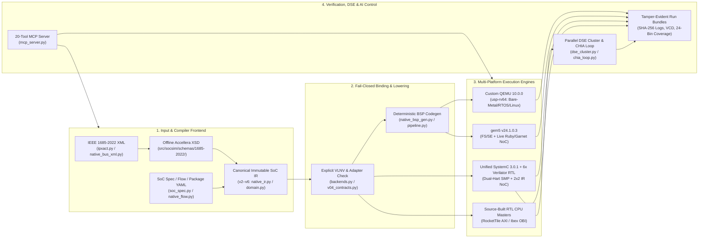

# System Architecture & Compatibility Boundary

| Metadata Field | Value |
|---|---|
| **Document ID** | `SOCSIM-ARCH-001` |
| **Current Version** | `0.3.0a5` |
| **Status** | Active / Normative Architecture Spec |
| **Normative Authority** | `src/socsim/ipxact.py`, `src/socsim/native_ir.py`, `src/socsim/pipeline.py`, `src/socsim/unified_systemc_soc.py`, `agent.md` |

---

## Document Revision History

| Version | Release Date | Milestone / Gate | Author / Scope | Detailed Summary of Changes |
|---|---|---|---|---|
| `0.1.0` | `2026-11-10` | Initial Baseline | Compiler Frontend | Offline IEEE 1685-2022 XSD validation, flat immutable `SoCIR`, fixed QEMU `virt` profile, hashed evidence capture. |
| `0.2.0` | `2026-11-16` | `v0.2.0` (`4d65eae`) | Multi-Engine & Source IPs | Added `usp-rv64-v1`/`hybrid`/`ips` custom generated QEMU machine, Zephyr/FreeRTOS/Linux bring-up, SystemC/Verilator Chipyard GCD & OpenTitan GPIO, scalar registers, bounded parameters, structural hierarchy. |
| `0.3.0a1–a4` | `2026-11-18` | `M1–M4` Alpha Series | Canonical Native IR | Unified Native IR v3–v5, static decoder lowering, IEEE 1685-2022 bus XML import/export, `native-model-package-1`, `usp flow`. |
| `0.3.0a5` | `2026-11-23` | `PR #1–#3` (`E1–E12`) & Refactor | Unified SystemC + Enterprise Stack | Added Native IR v6 (`RocketTile` source CPU), Dual-Hart SMP + 6× Verilator RTL unified SystemC emulator, IR NoC routing table, CHIA cyclic optimization loop, 20-tool MCP server, and industrial architecture documentation. |

---

## 1. End-to-End Platform Architecture

---

## 2. White-Box Source Code Execution Pipeline

Every hardware/software run traverses an explicit, deterministic Python-to-native pipeline with zero implicit network fetches or silent backend substitutions:

1. **Schema & Structural Intake** ([`ipxact.py`](../src/socsim/ipxact.py), [`native_bus_xml.py`](../src/socsim/native_bus_xml.py), [`soc_spec.py`](../src/socsim/soc_spec.py)):
   - Validates XML against bundled offline Accellera IEEE 1685-2022 XSD schemas (thread-safe serialized initialization). Rejects XML DTDs/external entities, duplicate YAML keys, and path traversal outside the project root.
   - Elaborates bounded unsigned integer parameters ([`parameters.py`](../src/socsim/parameters.py)), scalar register/field metadata ([`registers.py`](../src/socsim/registers.py)), and structural hierarchy ([`hierarchy.py`](../src/socsim/hierarchy.py)).
2. **Immutable Canonical IR Lowering** ([`domain.py`](../src/socsim/domain.py), [`native_ir.py`](../src/socsim/native_ir.py), [`native_fabric.py`](../src/socsim/native_fabric.py)):
   - Normalizes address spaces, bridge apertures, interrupt routes, clock/reset domains ([`native_domains.py`](../src/socsim/native_domains.py)), and initiator views. Rejects overlaps, 64-bit overflows, cycles, misalignment, and unsupported bus protocols before any code generation occurs.
3. **Fail-Closed Model & Adapter Qualification** ([`backends.py`](../src/socsim/backends.py), [`v04_contracts.py`](../src/socsim/v04_contracts.py), [`native_package.py`](../src/socsim/native_package.py)):
   - Resolves exact VLNV and SHA-256 package hashes (`native-model-package-1`). Unqualified `(provider, model, protocol, engine)` pairs fail explicitly with `ContractError` — never silently falling back to an ISS.
4. **Target Generation & Native Execution** ([`pipeline.py`](../src/socsim/pipeline.py), [`soc_native.py`](../src/socsim/soc_native.py), [`unified_systemc_soc.py`](../src/socsim/unified_systemc_soc.py), [`runner.py`](../src/socsim/runner.py)):
   - Generates target C machines, DTS, `soc.h`/`soc.ld`, and IR routing headers (`unified_soc_routes.h`), then launches subprocesses as explicit argument arrays with timeouts, process-group SIGTERM cleanup, raw log capture, and SHA-256 artifact manifests.

---

## 3. Dual-Layer Traceability: Hardware IP Platform vs. Simulator Execution Engine

| Hardware IP Platform / Origin | Concrete IP / Subsystem | Simulator Execution Engine & Actual Binding | Fidelity & Honest Boundary |
|---|---|---|---|
| **QEMU Upstream (`v10.0.0`)** | `usp-rv64` custom board, NS16550 UART, CLINT, PLIC, SiFive Finisher | Compiled QEMU `qemu-system-riscv64` (`pipeline.py`, `soc_native.py`) | Functional full-system ISA; optional event counters (explicitly labeled estimated CPI/IPC) |
| **gem5 Upstream (`v24.1.0.3`)** | TimingSimple/AtomicSimple RV64, Ruby `MI_example`, Garnet 2D Mesh | Compiled `RISCV/gem5.opt` (`USE_SYSTEMC=0`, `soc_native_gem5.py`, `fabric.py`, `coherent.py`) | Native cycle/packet/flit stats; PIO bypass disclosed where applicable |
| **Chipyard Upstream (`1.13.0`)** | `RocketTile` AXI CPU (L1/PTW/TLBroadcast), Chipyard Ibex, Chisel GCD | Verilated Chisel/CIRCT SV (`sbt 1.10.7`, `firtool 1.62.0`) over SystemC/QEMU/gem5 (`rocket_cpu.py`, `ipblocks.py`) | Real upstream RTL for selected cores/leaves; full Chipyard mega-SoC remains separate |
| **OpenTitan Upstream (`earlgrey_silver_release_v5`)** | `gpio.sv` + `tlul_pkg.sv`, `prim_fifo_sync.sv` | Verilator 5.032 + SystemC 3.0.1 bridge (`ipblocks.py`, `hybrid.py`) | Real upstream peripheral RTL; full EarlGrey security complex remains separate |
| **Unified Multi-Platform SoC (Original Clean-Room)** | Dual-Hart SMP `RV64IMA_Zicsr`, IR 2×2 NoC, `MAC NPU`, `SHA-256`, `AES-128`, `SPI`, `I2C`, `L2 Cache`, DMA, IOPMP | Single SystemC 3.0.1 `sc_main` + 6× Verilator 5.032 clean-room SV RTL (`unified_systemc_soc.py`) | Cycle-accurate RTL on 6 peripherals + TLM-2.0 annotated NoC/SMP CPUs; distinct from upstream silicon RTL |

---

## 4. Supported IEEE 1685-2022 Semantic Subset & Boundaries

### Accepted Semantics
- Top-level `component` and `design` VLNVs; `componentInstances` (`instanceName`, `componentRef`); `memoryMaps` / `addressBlock` (`baseAddress`, `range`, `width`, `usage`, `addressUnitBits=8`).
- Bounded unsigned integer parameter expressions (`parameters.md`), scalar registers and bitfields (`registers.md`), bounded structural hierarchy via `designConfiguration` (`examples/rv64-hierarchy.md`), and native bus/subspace XML import/export (`native-bus-xml.md`).

### Explicit Rejections (Fail-Closed)
- Everything outside the validated child/attribute subset is rejected before code generation: arbitrary parameter types/strings/vectors, implicit register side effects, non-structural views, vendor extensions, XML DTDs/entities, and path escapes.
- **This is not complete IEEE 1685 semantic compliance.** XSD validity is necessary but never sufficient.

---

## 5. Evidence Integrity, Reproducibility & Confidentiality

- **Relocatable IR & Reproducible Builds**: IR uses relative names and content hashes; bare-metal ELF debug paths and assembler intermediates are normalized across output directories.
- **Tamper-Evident Run Bundles**: Every run writes into a fresh output directory capturing IR, execution plan, argv/workdir, serial/error logs, tool binary hashes, ELF hash, and JSON/Markdown outcomes. Prior evidence is never overwritten.
- **Offline Schema Provenance**: Accellera IEEE 1685-2022 XSD assets under `src/socsim/schemas/1685-2022/` are loaded strictly offline with recorded mirror commit and per-file SHA-256 hashes. No telemetry or remote service calls occur during simulation.
- **Confidentiality**: Run bundles stay local and Git-ignored. Hosted CI executes only synthetic public fixtures.
