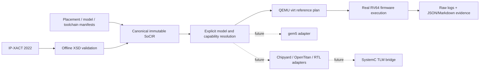

# Architecture and compatibility boundary

`ipxact.py` checks the 2022 namespace and bundled XSD before semantic intake.
`domain.py` contains immutable instances and byte-addressed windows. `project.py`
resolves explicitly named local files and manifest schema. `backends.py` resolves
exact VLNV bindings and enforces one fixed board contract. `runner.py` executes
argument arrays with timeouts, process-group cleanup, logs and content hashes.

## Supported 2022 semantic subset

Top-level component and design VLNVs; componentInstances/instanceName/componentRef;
memoryMaps/memoryMap/name/addressBlock/name/baseAddress/range/width/usage;
addressUnitBits=8. Numeric values are decimal or hex literals, never evaluated
Python/SystemVerilog expressions. The source catalog is `ipxact/**/*.xml`.
All instance placements must be explicitly listed in the simulation manifest.
The XML baseAddress is component-local; supplemental placement adds its offset.
Overlaps and unsigned 64-bit overflow are rejected; aliases are not implemented.

Everything outside the accepted child/attribute sets is rejected, including
parameters, registers/fields, busInterfaces, interconnections, views, fileSets,
designConfiguration, hierarchy and vendor extensions. This is **not complete
IEEE 1685 semantic compliance**. XSD validity is necessary but insufficient.
`socsim validate` checks this metadata subset; `socsim plan` additionally checks
the selected backend and profile. XML DTD/entities, YAML duplicate keys and source
path escapes are rejected. XSD loading and XML parsing do not fetch network URLs.

## QEMU reference profile

`qemu-virt-rv64-v1` requires exactly one bound RV64 CPU, 128 MiB RAM at 0x80000000,
NS16550 window at 0x10000000 and SiFive test window at 0x100000. Widths and ranges
must match. It selects existing upstream `virt`; it does not generate custom
QOM code. Implicit upstream devices include ROM, interrupt controllers, timer and
other board hardware. They are not reconstructed from these minimal descriptors.
Functional CPU execution does not establish matching cache timing, custom ISA,
PMP/security, DMA or IRQ correctness. CPU state and RAM have a single owner: QEMU.

The XML schemas are public Accellera assets fetched through the pinned public
edaa-org mirror because the direct origin is unavailable in this environment.
Provenance includes the mirror commit and SHA256 of every XSD. No confidential
input was sent to that mirror. Dependency artifacts are pinned by `uv.lock`.

## Evidence and reproducibility

The IR uses relative names and hashes, so relocation does not change its contents.
Run bundles include IR, plan, argv/workdir, exact input snapshots, serial/error
logs, simulator binary identity/hash, ELF hash and JSON/Markdown outcome. The ELF
itself remains an external artifact; keep it with controlled storage if replay is
required. A QEMU version pin is not a full source-build lock: record actual binary
hash and distro revision; future profiles must pin source/patches/firmware toolchains.
Wall time is measured; simulated cycles/time are unavailable for this profile.

Run bundles can contain private project inputs. Keep them local; the provided CI
executes only synthetic fixtures and uploads only its JUnit results. No telemetry,
remote simulator service or automatic dependency upgrades occur during simulation.

## v0.2 generated-machine path

The earlier sections describe the retained v0.1 metadata/virt path. Manifest
schema_version=2 adds hardware.yaml with typed CPU, reset/entry, IRQ routes and an
explicit CPU address space. The supported custom profiles are usp-rv64-v1 and
usp-rv64-hybrid-v1. They require exact role/VLNV/model contracts and fixed validated
window sizes but permit supported relocation. The UART is relocated to 0x11000000.

pipeline.py generates C machine source, Zephyr board/DTS/application, software
contract, C address header and memory layout from validated inputs. It integrates
QEMU APIs verified against source SHA, compiles the machine into usp-rv64, and builds
Zephyr through west. UART clock/baudbase come from the same explicit model contract;
the new custom profile does not inherit the legacy virt clock mismatch.

schemas/ir-v2.json exports the typed IR structure, hardware-v1.json describes the
strict overlay, and model-catalog-v1.json identifies exact source/contract versions.
The importer still rejects unsupported standard XML semantics. The current IR has
one initiator-visible address space; no general translations or hierarchy are claimed.

linux.py builds a static original init/workload, tiny Linux and OpenSBI fw_payload,
and generates/loads a Linux DTS. Linux needs a shared-capable Linux GNU linker for
vDSO; the bare-metal linker is rejected by a preflight compile/link probe. The boot
contract is generated ROM → OpenSBI M mode → Linux S mode → initramfs PID 1. This
is separate from building a Yocto root filesystem and separate from secure boot.

gem5.py is an explicitly scoped SE adapter for the identical Linux-ABI workload,
not a binding for this complete hardware topology. It leaves MMIO/IRQ devices
unmodeled and records fixed uncalibrated CPU/memory assumptions. QEMU retains full
CPU/RAM ownership in the hybrid profile; hybrid.py manages a local SystemC model,
with an optional real OpenTitan FIFO RTL implementation compiled by Verilator.
The transaction/time contract is documented in the hybrid example guide.

Generation manifests bind compiler module, template, catalog, input and output
hashes. Build records bind binary/ELF identities to that manifest. Old outputs must
be regenerated when any input identity changes. All run artifacts remain ignored
and may contain private inputs; hosted CI only executes original synthetic fixtures.

freertos.py independently generates and builds the original static-allocation BSP
against the unmodified source-pinned upstream RV64 port. It consumes verified
soc.h/memory.ld and the same timer/IRQ IR, then binds the software resources,
adapter and ELF in freertos-build.json. It does not change the hardware generation
manifest when adding this optional software build. Its runner verifies both
software and QEMU identities, captures real tick/preemption/PLIC evidence and
cleans up owned native processes on timeout or cancellation.

`usp-rv64-ips-v1` has separate exact Chipyard GCD and OpenTitan GPIO roles/VLNVs,
placements, address windows and unique IRQ routes. ipblocks_codegen.py lowers
the dual-window QEMU transport and Zephyr device/guest tests; only this profile
hashes those additional generation templates. ipblocks.py compiles the verbatim
selected Chipyard Chisel classes and actual OpenTitan GPIO/TL-UL in a separate
SystemC/Verilator process. It checks the generator dependency content lock and
captures actual RTL source inputs, generated SV and binary identities. QEMU owns
CPU/RAM; the native process owns the two peripheral states and advances only on
transactions. The rv64-ips guide documents the MMIO/IRQ shim, loopback, protocol,
time annotations, evidence and full-SoC boundaries.
