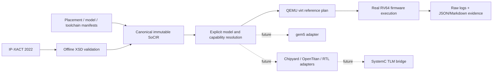

# Architecture and compatibility boundary

`ipxact.py` checks the 2022 namespace and bundled XSD before semantic intake.
`domain.py` contains immutable instances and byte-addressed windows. `project.py`
resolves explicitly named local files and manifest schema. `backends.py` resolves
exact VLNV bindings and enforces one fixed board contract. `runner.py` executes
argument arrays with timeouts, process-group cleanup, logs and content hashes.

## Supported 2022 semantic subset

Top-level component and design VLNVs; componentInstances/instanceName/componentRef;
memoryMaps/memoryMap/name/addressBlock/name/baseAddress/range/width/usage;
addressUnitBits=8. Numeric values are decimal or hex literals, never evaluated
Python/SystemVerilog expressions. The source catalog is `ipxact/**/*.xml`.
All instance placements must be explicitly listed in the simulation manifest.
The XML baseAddress is component-local; supplemental placement adds its offset.
Overlaps and unsigned 64-bit overflow are rejected; aliases are not implemented.

Everything outside the accepted child/attribute sets is rejected, including
parameters, registers/fields, busInterfaces, interconnections, views, fileSets,
designConfiguration, hierarchy and vendor extensions. This is **not complete
IEEE 1685 semantic compliance**. XSD validity is necessary but insufficient.
`socsim validate` checks this metadata subset; `socsim plan` additionally checks
the selected backend and profile. XML DTD/entities, YAML duplicate keys and source
path escapes are rejected. XSD loading and XML parsing do not fetch network URLs.

## QEMU reference profile

`qemu-virt-rv64-v1` requires exactly one bound RV64 CPU, 128 MiB RAM at 0x80000000,
NS16550 window at 0x10000000 and SiFive test window at 0x100000. Widths and ranges
must match. It selects existing upstream `virt`; it does not generate custom
QOM code. Implicit upstream devices include ROM, interrupt controllers, timer and
other board hardware. They are not reconstructed from these minimal descriptors.
Functional CPU execution does not establish matching cache timing, custom ISA,
PMP/security, DMA or IRQ correctness. CPU state and RAM have a single owner: QEMU.

The XML schemas are public Accellera assets fetched through the pinned public
edaa-org mirror because the direct origin is unavailable in this environment.
Provenance includes the mirror commit and SHA256 of every XSD. No confidential
input was sent to that mirror. Dependency artifacts are pinned by `uv.lock`.

## Evidence and reproducibility

The IR uses relative names and hashes, so relocation does not change its contents.
Run bundles include IR, plan, argv/workdir, exact input snapshots, serial/error
logs, simulator binary identity/hash, ELF hash and JSON/Markdown outcome. The ELF
itself remains an external artifact; keep it with controlled storage if replay is
required. A QEMU version pin is not a full source-build lock: record actual binary
hash and distro revision; future profiles must pin source/patches/firmware toolchains.
Wall time is measured; simulated cycles/time are unavailable for this profile.

Run bundles can contain private project inputs. Keep them local; the provided CI
executes only synthetic fixtures and uploads only its JUnit results. No telemetry,
remote simulator service or automatic dependency upgrades occur during simulation.
