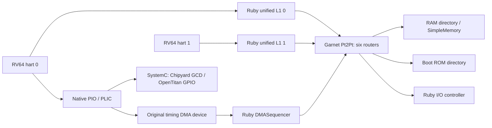

# Native coherent DMA and two-hart Garnet reference

`usp coherent` runs an original two-hart bare-metal application in native gem5
while actual Chipyard GCD and OpenTitan GPIO RTL execute in the same SystemC
process used by the existing unified platform. It is an additional explicit
profile, preserving the previous single-hart Zephyr and RTL-master adapters.

The pinned gem5 revision is b9da2bfe1e21f6efa2730edd4e80e58c5d965458.
`platforms/*-coherent.yaml` explicitly declares two harts and DMA placement/IRQ.
The lowerer records both the original IR and a derived IR with the second hart,
two caches, DMA and NoC. Both CPU address spaces include DMA registers; the DMA
address space contains only RAM. Overlap, interrupt reuse, invalid widths/ranges,
unknown fields and unsupported hart counts are rejected before execution. This
bounded backend profile does not implement general IP-XACT bus inference.



Both harts are RiscvTimingSimpleCPU at 1 GHz. Each has a unified 32 KiB, two-way
MI_example cache with 64 B lines. The RAM directory, ROM directory, two L1
controllers, DMA controller and I/O controller each have one router. ROM latency
is 10 ns, upstream SimpleMemory RAM latency is 30 ns, and DMA PIO latency is 20 ns.
These are configured evaluation parameters, without silicon timing calibration.
There is one RAM owner. DMA uses native asynchronous DmaPort timing reads/writes
through Ruby's DMASequencer; it never directly copies into backing RAM.

The original DMA is a reference copy engine, **not** Chipyard/OpenTitan DMA IP.
Its 4 KiB window has aligned 32-bit registers: source low/high at 0/4, destination
low/high at 8/12, length at 16, control/status at 20, completed copies at 24 and
errors at 28. Write control 1 to start, 0 to acknowledge/clear its native PLIC
interrupt. Status 1 means busy, 2 complete, 4 descriptor error. Length must be
1..4096 bytes; both complete spans must fit in declared RAM. Active descriptors
cannot be overwritten. Other register accesses and checkpointing fail explicitly.
The accepted fixture tests 512-byte copies, ROM-source and zero-length rejection;
it does not claim exhaustive device conformance or an IOMMU implementation.

```sh
usp coherent build-engine --source .tools/upstream/gem5 \
  --out build/coherent-gem5 --jobs 2
usp coherent run systems/AI_SOC/bringup --generated build/AI_SOC \
  --models build/source-ip-models --bridge build/coherent-gem5 \
  --source .tools/upstream/gem5 --profile platforms/AI_SOC-coherent.yaml \
  --out results/AI_SOC-coherent
usp coherent verify results/AI_SOC-coherent
```

Build the native base gem5 first as documented in build-reproducibility.md. Native
extensions use an exclusive source-build lock; do not concurrently configure that
source tree. The builder records source/resources/configuration/binary identities
and preserves/restores the original gem5 executable. Existing SystemC IP models
and generated base designs are verified before use. All output paths must be new.

Acceptance requires 32 bidirectional shared-memory exchanges between the two
harts, four copies from dirty cached source into dirty cached destination without
cache flush/invalidation, all data words checked by the guest, six real DMA
interrupts including two rejected descriptors, and actual GCD/GPIO results/IRQs.
Native DMA callbacks record ordered start/read/write/ack ticks and checksums;
the verifier independently computes expected payload checksums. CPU I/D and DMA
port peers must point into Ruby; native packet/flit counters and both harts'
instruction/cycle counters must be positive. Firmware corruption deliberately
fails the guest finisher. Modified configuration or missing ELF inventory fails
portable verification. Raw firmware, ELF, IR, config, UART, traces, stats, source
helpers, process exits and licenses are hashed in each JSON/Markdown run bundle.

The three-map native test passed on 2026-11-14. The observed reference hart counts
were 12,529 / 5,377 instructions and 112,871 / 24,751 native CPU cycles. CPI/IPC
are gem5 whole-fixture counters with each CPU's native idle accounting; they are
not application ROI or silicon predictions. `tests/test_coherent.py` has 18
positive/negative checks, including an actually failing corrupted-data guest.
Promotion requires USP_REQUIRE_COHERENT=1 and USP_COHERENT_BUILD. The manual
unified workflow builds the extension and runs this gate; hosted results remain
separate from local results.

PIO still bypasses Garnet. SystemC IP clocks remain transaction-driven. This
profile does not add QEMU/RTL-master coherent DMA, arbitrary coherence protocols,
Rocket/BOOM, SMP OS/Linux, global clock correlation, checkpointing, a synthesizable
Garnet NoC, or the complete 46/37-instance architectures. See next-version.md.
