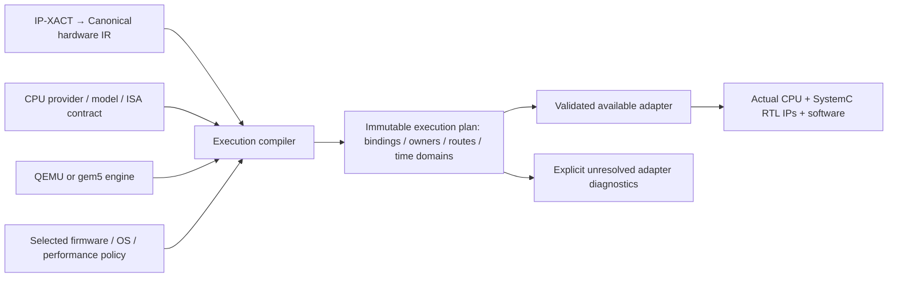

# CPU provider, execution engine and workloads are separate inputs

The requested CPU is the SoC's target CPU, distinct from the workstation running
the simulators. A provider/model selects the CPU implementation; an engine selects
the execution environment. Workload selection and performance policy are separate.
An adapter must exist for the requested combination; matching RISC-V ISA alone
does not execute another simulator's CPU or an RTL CPU.



Current available and actually exercised adapters:

| CPU provider/model | Engine | Performance |
|---|---|---|
| QEMU rv64 | QEMU TCG | Actual event counts; analytical CPI/IPC estimates |
| QEMU max | QEMU TCG | Same counter API, explicit selected model |
| gem5 TimingSimpleCPU | gem5 | Native committed-instruction/cycle statistics |
| gem5 AtomicSimpleCPU | gem5 | Native statistics; instruction/data stalls enabled |

Both alternate models passed bare-metal, FreeRTOS, Zephyr and Linux/boot sequence.
These profiles are currently single-hart RV64 source-IP boards. Additional ISA,
multi-hart, cache/coherence and microarchitecture contracts require actual adapters
and tests. Available models may expose extra ISA features; workloads are restricted
to their declared IR/software ISA and context contract.

Chipyard Rocket/BOOM and custom RTL CPU requests are recognized as NEEDS_ADAPTER.
They are not silently replaced by an ISS. A CPU RTL adapter needs actual source
pins/ports, clock/reset, instruction/data bus-master protocol, IRQ/debug and memory
ownership contracts, plus counter/retirement observability. That is different from
the existing SystemC MMIO target bridge for peripheral RTL. QEMU-CPU-in-gem5 and
gem5-CPU-in-QEMU also need explicit cross-ISS adapters; none is claimed implemented.

The separate Ibex RTL test chips prove direct RTL firmware execution and physical
flow; they do not yet implement an external RTL CPU bus-master into these engines.
The platform architecture permits additional registered adapters; configuration
does not manufacture missing CPU semantics or interfaces.

## Configure a run

Original reference YAML files under platforms contain explicit workloads. Edit
or author a configuration; there is no mandatory fixed software scenario:

```yaml
schema_version: '1'
cpu:
  provider: gem5
  model: atomic-simple
  clock_hz: 1000000000
engine: gem5
workloads: [baremetal, linux]
```

```bash
usp platform plan examples/rv64-ips --config platforms/gem5-atomic.yaml
usp platform run examples/rv64-ips --config platforms/gem5-atomic.yaml \
  --generated build/rv64-ips --models build/source-ip-models \
  --bridge build/unified-gem5 --out results/platform-001
usp platform verify results/platform-001
```

For QEMU choose platforms/qemu-rv64.yaml or qemu-max.yaml and pass --counter to
the verified native plugin. qemu_cost_model supplies explicit base_cpi and
memory_extra_cycles. It cannot override gem5 native statistics. QEMU clock_hz is
a target reference parameter, not a claim that TCG models physical CPU cycles.

Planning Chipyard/custom RTL profiles emits the unresolved combination and exits
nonzero. Execution refuses it before starting a model or creating a successful run.
Unknown model strings are identifiers, never Python imports, shell commands or
automatic downloads. The schema rejects unknown fields and duplicate workloads.

Reference applications are optional. An artifacts mapping can bind a selected
workload to an external ELF: supply elf, sha256 and expected_markers, plus dtb and
dtb_sha256 when needed. Paths are relative to the configuration file or absolute.
The loader checks hashes, ELF64/little-endian/RISC-V container, declared reset entry
and physical load bounds against owned ROM/RAM. It does not statically prove every
instruction's ISA legality. Compile for the IR ISA/context/boot contract.

External images run on the actual selected CPU and must reach the real finisher;
markers are acceptance inputs, never host-emitted output. No reference GCD/GPIO or
OS internals are claimed exercised just because an external image completes.
Firmware/DTB copies and their identities remain in ignored local result bundles,
not public source or CI uploads. platform verify checks the portable evidence.

The immutable execution plan records one CPU engine owning ROM/RAM, each model's
source/domain, routed addresses/IRQs and independent time-domain meanings. Actual
IPC traces are checked for sequence, address/width/IRQ and monotonic annotated
time. This does not claim asynchronous global time synchronization. The richer
co-design direction and research evaluation are in research-direction.md.
