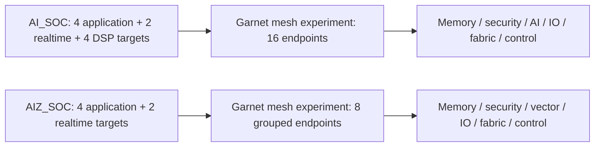

# AI_SOC and AIZ_SOC

The owner selected RISC-V for both systems and requested emulator, firmware/OS,
RTL synthesis and ASIC implementation where supported. Only these sanitized
names are used. The reference image and its original labels are not stored in Git.
These are two independent configurations, not a verified chip-to-chip system.

## Architecture targets

| Contract | AI_SOC | AIZ_SOC |
|---|---|---|
| Application processors | 4 Rocket candidates, 32 KiB instruction/data cache per CPU | 4 Rocket candidates, same cache targets |
| Realtime processors | 2 Ibex candidates | 2 Ibex candidates |
| DSP processors | 4 RISC-V vector/DSP candidates | None in this configuration |
| Shared application L2 | 2 MiB | 1 MiB |
| OCM / TCM / DRAM windows | 256 KiB / 256 KiB / 2 GiB | Same |
| Acceleration | AI engine candidate, 4 MiB cache; FEC/FFT/OFDM and control blocks | Vector/AI candidate, 64 KiB cache; no GPU compatibility claim |
| Programmable logic | Fabric and bitstream integration required | Fabric and bitstream integration required |
| Architectural instances | 46 | 37 |
| Garnet experiment | 16 routers, 4 by 4 mesh | 8 routers, 2 by 4 mesh |

These numbers are explicit emulator design choices, not measured hardware
properties. Vector/DSP algorithms, accelerator interfaces, memory controllers
and PHY implementations require concrete model/RTL contracts before execution.
CPU candidates are not substitutes for the original processors' ISA or timing.



Each systems/NAME/architecture contains XSD-valid IEEE 1685-2022 XML, explicit
placements and an architecture-only manifest. It has no executable model bindings.
system.yaml associates every instance with a candidate provider/model and NoC
endpoint. All endpoints must be used and all architecture instances accounted for.
The strict system-v1 schema rejects unknown fields; paths stay inside the system.
The IR elaborates the full architecture, but does not yet implement its buses,
clocks, resets, processor domains or register behavior.

## Public model choices and gaps

| Function | Preferred provider | Current integration boundary |
|---|---|---|
| Application CPU/cache/SRAM/boot/debug | Chipyard Rocket, inclusive cache, TLRAM | Full heterogeneous integration open |
| Realtime CPU | OpenTitan Ibex | Full core/firmware integration open |
| GPIO, serial controllers, timer/watchdog, reset/clock/power | OpenTitan | Actual GPIO/TL-UL works in bring-up; other bindings open |
| AES/hash/bignum/entropy/RNG | OpenTitan AES/HMAC/OTBN/entropy_src/CSRNG | Full security-domain integration open; no signoff claim |
| AI/vector acceleration | Chipyard Gemmini/vector candidates | Source selection, ISA, DMA and software contracts open |
| Ethernet | Chipyard IceNet candidate | Full MAC/DMA/PHY path open |
| Network timing | gem5 Garnet | Actual independent synthetic mesh experiments |
| NoC RTL | Chipyard Constellation candidate | Not selected/implemented; Garnet is not synthesizable RTL |
| LVDS/eMMC/high-speed IO, fabric, signal-processing accelerators | Additional implementations required | No fake or no-op models supplied |

All selected upstream source pins are in each system.yaml and checked against the
actual adapter pins. Descriptor names in the architecture use our own VLNV
namespace; they are not upstream-issued executable IP packages. Pinning the
Chipyard repository does not initialize or verify all its nested submodules.

## Executable bring-up and its limits

systems/NAME/bringup uses the existing strict nine-role model contract: one QEMU
RV64 hart and RAM, ROM, UART, CLINT, PLIC, finisher, actual Chipyard GCD and actual
OpenTitan GPIO RTL. This is a supported subset of each target. GCD is a conformance
accelerator, not an AI/FEC/FFT replacement. AIZ_SOC relocates UART/GCD/GPIO and
uses different PLIC lines so both generated maps are independently exercised.
Zephyr builds against each generated DTS and passes actual timer/UART/PLIC and
GCD/GPIO tests. These ELF files do not boot the full 46/37-instance targets.

Garnet uses the pinned gem5 v24.1.0.3 Garnet_standalone protocol, Mesh_XY and XY
routing, 1 GHz clocks, 128-bit links, four VCs per vnet and vnet 0 traffic. The
16/8 named endpoints label synthetic traffic generators/directory sinks. They
are not running Rocket/Ibex/accelerator models. The tests are independent of
Zephyr and the SystemC bridge; live coupling remains an explicit requirement.
The upstream --sim-cycles flag compares raw curTick in this revision, so the
configuration explicitly calls it simulation_ticks. A fixed cut-off can leave
packets in flight; received packets are checked positive and <= injected packets.
The versioned adapter explicitly configures RubyCache.block_size=64B and fixes
the standalone protocol's unallocated dummy DataBlock through a reviewed
initialization patch. The upstream tree is restored after compilation; the
patch and resulting binary are hashed. Routing and packet state machines remain
upstream implementations. Statistics are uncalibrated simulator results, not
production performance estimates.

Yosys 0.52 synthesizes the actual generated Chipyard GCD leaf and checks equivalence
with the input RTL using equiv_status -assert. CIRCT emits without local automatic
variables for Yosys compatibility; the selected original Chisel classes remain
unchanged and the native RTL models are rebuilt/tested. Generic synthesis is independent of the added OpenROAD reference flow in
openroad.md. The actual GCD leaf additionally completes Nangate45 mapping,
placement/CTS/routing and GDS generation, with zero detailed-router DRC and
nonnegative setup/hold slack. This does not implement the complete SoC top.

## Build and test

First build the source-IP models as documented in examples/rv64-ips.md. Install
Yosys 0.52 and yosys-abc; the rootless Debian helper setup_synthesis_tools.sh
uses signed package indexes. Acquire the pinned gem5 source explicitly. Then:

```bash
source .venv/bin/activate
export CROSS_COMPILE=riscv64-unknown-elf-
export USP_UPSTREAM_ROOT=/path/to/pinned/upstreams
bash scripts/dual_soc_bringup.sh

usp system plan systems/AI_SOC
usp system plan systems/AIZ_SOC
usp system test systems/AI_SOC --generated build/AI_SOC \
  --models build/source-ip-models --noc-build build/garnet \
  --scope bringup --out results/ai-soc-bringup-001
usp system verify results/ai-soc-bringup-001
usp workspace test workspace.yaml --out results/ten-target-001
usp workspace verify results/ten-target-001
```

Use a new output directory per run. The ten-target workspace includes both
three-stage system bring-ups. Missing dependencies fail the required gate.
Reports retain original logs, exact hashes, NoC configuration/statistics,
generic netlists and equivalence results. Modified evidence and false full-system
completion claims are rejected. Files remain local and ignored by Git.

Omitting --scope bringup requests full acceptance. It runs the independent
implemented checks, reports BLOCKED if they pass but full requirements remain
unimplemented, and returns nonzero. A failed selected stage reports FAILED.
No command reports a complete heterogeneous SoC or physical implementation yet.

## ASIC exit conditions

The full targets still need an elaboratable CPU/cache/NoC/peripheral RTL top,
real accelerator/fabric/PHY implementations and validated clock/reset/interrupt
connections. A complete ASIC flow additionally needs the selected public or
authorized PDK, Liberty/LEF/technology files, SDC, power intent, macro/IO planning,
technology mapping, STA, floorplan, placement, clock-tree synthesis, routing and
DRC/LVS/antenna acceptance. OpenROAD availability alone does not close these items.
Public reference libraries can validate a flow; they are not production signoff.
Proprietary libraries, design keys and raw company reference inputs stay outside Git.
