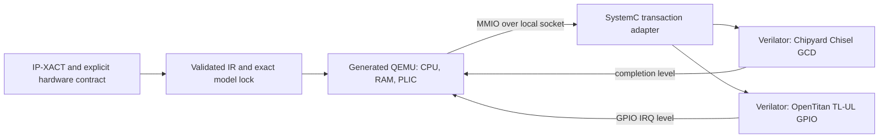

# Chipyard and OpenTitan source IP profile

`examples/rv64-ips` is an original synthetic IEEE 1685-2022 design with nine exact
roles: RV64 CPU, RAM, ROM, CLINT, PLIC, UART, finisher, Chipyard GCD and OpenTitan
GPIO. Supplemental placements put GCD at 0x13000000 and GPIO at 0x14000000. Their
distinct PLIC sources are 12 and 13; UART remains relocated to 0x11000000.
The profile is `usp-rv64-ips-v1`, separate from the earlier FIFO hybrid profile.



## Reproduce

Use the existing frozen Python bringup extras, the source-built QEMU prerequisites,
GNU RISC-V unknown-elf GCC 14.2.0, SystemC 3.0.1, Verilator 5.032 and Java 21. See
build-reproducibility.md for signed rootless Debian tools. Java must already be
available; on a supported Debian host install openjdk-21-jdk-headless through the
approved package installer. No untrusted installer or relaxed TLS is required.

```bash
source .venv/bin/activate
# Rootless installations also source their env_bringup.sh here.
export CROSS_COMPILE=riscv64-unknown-elf-
export USP_FETCH_MODELS=1 USP_FETCH_CHIPYARD=1
bash scripts/fetch_upstreams.sh
bash scripts/setup_chipyard_tools.sh
bash scripts/source_ips_bringup.sh
```

The source cache is selected by USP_UPSTREAM_ROOT. USP_CHIPYARD_TOOLS selects the
immutable tool downloads, USP_SCALA_CACHE the writable Maven/SBT caches,
USP_IP_MODELS_DIR the native model build, and USP_IP_GENERATED_DIR the generated
machine/Zephyr build. Default jobs=2; this selected generator accepts at most four.
Explicit native build/run commands are:

```bash
usp generate examples/rv64-ips --out build/rv64-ips
usp build examples/rv64-ips --generated build/rv64-ips --source-qemu .tools/upstream/qemu
usp software build examples/rv64-ips --os zephyr --generated build/rv64-ips \
  --source-zephyr .tools/upstream/zephyr --cross-compile riscv64-unknown-elf-
usp ipblocks build --source-chipyard .tools/upstream/chipyard \
  --source-opentitan .tools/upstream/opentitan --tools .tools/chipyard \
  --scala-cache .cache/scala --out build/source-ip-models
usp test examples/rv64-ips --generated build/rv64-ips --bridge-mode rtl \
  --bridge-models build/source-ip-models --out results/source-ips-001
usp report results/source-ips-001 --format md
```

Generation/run do not download dependencies. Tool acquisition is explicit; SBT
dependency resolution occurs during the selected model build, before compilation.
Normal core tests do not require Java/Chipyard/SystemC. The native promotion gate
requires actual models and guest builds through USP_REQUIRE_IPS=1.

## Chipyard source boundary

Chipyard 1.13.0 is pinned at 69eba860a352343e4ac6b6df0f3638a79a86ec78, BSD-3-Clause.
The original GCD.scala file is content-verified. Complete GCDIO and
GCDMMIOChiselModule classes are selected verbatim into an ignored build directory;
only package/import scaffolding and an original emission entry point are added.
No GCD algorithm is rewritten or replaced by a host implementation. Real Chisel
6.5.0 / Scala 2.13.12 compilation and CIRCT firtool 1.62.0 produce the SV compiled
by Verilator. A 63-artifact content lock verifies the actual resolved generator
compilation dependencies. Launcher and native firtool artifacts have fixed SHA256.

This is an isolated build of selected Chipyard classes. Chipyard's original SBT
1.8.2 failed against the host Java 21; the separate adapter pins SBT 1.10.7, with
the original Chisel/Scala versions retained. No upstream checkout is modified.
Rocket, Diplomacy, CPU configurations and Chipyard submodule builds are not used
or claimed. The generated GCD core is not its native TLRegisterNode: an explicitly
original MMIO shim follows the documented 0/4/8/12 status/x/y/result map and adds
a level completion IRQ. Reading a valid result consumes it and clears the IRQ.
Busy starts, writes to status, empty-result reads and zero operands are rejected.
Zero x would otherwise leave the upstream repeated-subtraction core running.

## OpenTitan source boundary

OpenTitan silver release v5 is pinned at ed044fc9760bdf9fc075d0015ba1db07fa075355,
Apache-2.0. This profile builds the actual GPIO peripheral, generated register bank,
TL-UL register adapter, command integrity checker, response integrity generator,
interrupt/filter primitives and alert sender. Its top_earlgrey top_pkg defines
the real TL-UL widths. Abstract prim_buf is bound to the upstream generic primitive.
Alerts select the supported synchronous parameter and default differential receive
pins. The wrapper explicitly loops output-enabled GPIO pins into their inputs.

Every GPIO transfer goes through TL-UL A/D handshakes with valid command parity.
The adapter holds D ready low for three cycles and checks response/data/error
stability and actual response integrity before accepting. Host conformance corrupts
command ECC and requires both a bus error and the real alert output; reset clears
the latched fault. This does not establish OpenTitan security/signoff or integrate
Earlgrey's CPU, interconnect, boot ROM, flash, lifecycle or cryptographic subsystem.
Upstream assertion macros use their Verilator policy; independent executable
checks remain active, without claiming the full OpenTitan UVM/SVA suite ran.

## Bridge, timing and acceptance

Protocol uses five little-endian 32-bit words per request/response, magic
0x31505355 and sequential frame IDs. Operations are read=0, write=1, reset-both=2;
host-only corrupt-command read=3 is limited to GPIO. Encoded offsets 0x0000–0x0fff
select GCD and 0x1000–0x1fff select GPIO; the actual GPIO aperture is 64 bytes and
higher aliases are rejected. Only aligned 32-bit accesses are supported. Response
IRQ bits 0/1 represent GCD/GPIO. QEMU drives its PLIC inputs only on level changes.
Malformed frames fail without write/reset side effects and consume one frame ID.

QEMU alone owns CPU/RAM. A local owned SystemC process drives both RTL IPs with
one common clock, annotating 10 ns per explicit RTL cycle. Clock progress occurs
only on model transactions; status polls drive GCD progress. There is no independent
asynchronous RTL scheduling, CPU-cycle correlation, DMA, coherent/shared RAM or
general bus fabric. Transport time and loop iterations are not silicon performance.

Guest Zephyr acceptance includes the existing timer/UART/PLIC tests, then four
actual GCD results (6, 6, 255, 1) consumed in a PLIC ISR. GPIO acceptance enables a
rising-edge event, changes an output pin, verifies input readback, handles its PLIC
ISR and clears INTR_STATE by W1C, then verifies a masked output clear. Success
requires USP_CHIPYARD_GCD_IRQ_OK, USP_OPENTITAN_GPIO_IRQ_OK, USP_TEST_PASS and exit
zero. Host tests also exercise reset during work, illegal/busy accesses, malformed
protocol, command-integrity failure, response backpressure and modified artifacts.

The run bundle contains raw serial, ordered RTL transaction trace, actual build/
tool/source/model hashes and retained BSD/Apache license texts. Repeated guest
traces must match byte for byte. Missing tools fail promotion, rather than turning
an optional developer skip into a release pass. Failed historical runs remain
failed evidence. No image/compiler timing or full-SoC integration is inferred.
