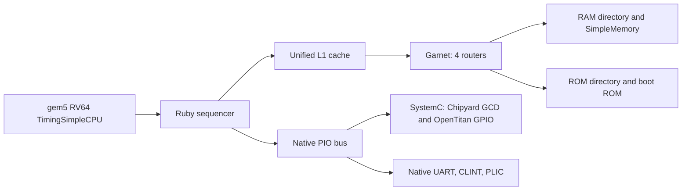

# Live Garnet in the unified gem5/SystemC SoC

`usp fabric` executes the existing generated Zephyr ELF with actual Chipyard GCD
and OpenTitan GPIO RTL in the shared SystemC process. Native gem5 TimingSimpleCPU
instruction/data cache accesses use Ruby MI_example and Garnet; this workload
creates network traffic as it executes. This is separate from the standalone
synthetic-traffic Garnet experiment.

The supported reference has one RV64 hart and four point-to-point-connected
routers, one per controller: unified L1 cache, RAM directory, boot-ROM directory
and Ruby I/O controller. The unified L1 is 32 KiB, two-way; cache lines are 64 B.
CPU/Ruby clocks are 1 GHz; RAM uses the upstream SimpleMemory default of 30 ns,
and boot ROM uses 10 ns. These are explicit uncalibrated evaluation parameters.
The CPU I/D ports connect directly to its Ruby sequencer. There is one physical
RAM owner. Boot ROM also has a Ruby directory; treating it only as PIO produces
an invalid destination because gem5 recognizes it as physical memory.



PIO takes the Ruby sequencer's native PIO path and bypasses Garnet. SystemC IPs
remain transaction-driven. The instantiated I/O controller is not proof of actual
device DMA or coherence. Multihart coherence, QEMU/RTL-master traffic through
Garnet, global timing correlation, checkpoint and a synthesizable NoC counterpart
remain open. The four-router fixture is not the complete 16/8-router architecture.

The pinned clean gem5 source is required for its version-matched Ruby Python
configuration helpers. These are copied into the run bundle, with file hashes and
the original license; upstream files are not modified. The existing verified
unified bridge binary is reused, without rebuilding native gem5.

```sh
usp fabric run systems/AI_SOC/bringup --generated build/AI_SOC \
  --models build/source-ip-models --bridge build/unified-gem5 \
  --source .tools/upstream/gem5 --out results/AI_SOC-live-garnet
usp fabric verify results/AI_SOC-live-garnet
```

Acceptance requires the real Zephyr boot/timer/UART/GCD/GPIO markers, actual
MMIO/readback/interrupt traces, successful finisher and process exits, CPU I/D
wiring into Ruby, separate ROM/RAM directory ownership, native CPU execution,
positive packet/flit counts and inter-router hops. Both artifact integrity and
recomputed acceptance are checked. The ELF, IR, board/configuration, native stats,
UART, trace, source helpers and provenance are retained for portable verification.
Reported CPI/IPC and network statistics are native gem5 counters for the whole
boot, including WFI idle; they do not establish application ROI or silicon timing.

The actual three-map regression passed on 2026-11-13. The rv64-ips reference
observed 37,706 instructions, 608 packets and 1,824 flits received, with average
one inter-router hop. Values are observed fixture results, not expected constants
for other firmware. `tests/test_live_fabric.py` also rejects a configuration
artifact changed to bypass Ruby. Promotion requires USP_REQUIRE_LIVE_GARNET and
USP_GEM5_SOURCE in addition to the existing unified/native roots. The manual
unified-soc workflow includes this gate; hosted execution still needs a provisioned
runner and is distinct from the local acceptance result.
