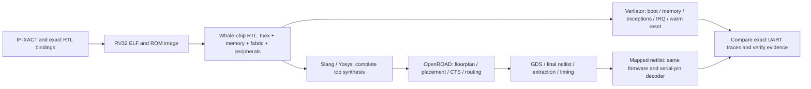

# Complete functional RTL test-chip configurations

AI_SOC and AIZ_SOC now have separate CPU-owned RTL test-chip profiles under
systems/NAME/rtl-testchip. Each profile binds every one of its nine declared
components and runs actual RISC-V firmware on the RTL CPU. The larger 46/37-instance
architecture targets remain separate and incomplete. These small public profiles
provide executable end-to-end flow tests while the remaining accelerator, PHY,
heterogeneous-core and fabric implementations are developed.

| Contract | AI_SOC test chip | AIZ_SOC test chip |
|---|---|---|
| CPU | Actual OpenTitan-vendored Ibex, RV32IMC + CSR/fence, M mode | Same ISA, different pipeline |
| Pipeline | Two-stage, no separate branch target ALU | Writeback stage and branch target ALU enabled |
| Boot ROM | 8 KiB at 0, entry 0x80 | 8 KiB at 0x10000, entry 0x10080 |
| SRAM | 1 KiB at 0x10000000 | 2 KiB at 0x10001000 |
| UART / GPIO / GCD / timer | 0x18000000 / 0x18001000 / 0x18002000 / 0x18003000 | 0x19000000 / 0x19001000 / 0x19002000 / 0x19003000 |
| Finisher | 0x18004000 | 0x19004000 |
| Clock constraint | 50 MHz reference | 50 MHz reference |

The actual OpenTitan UART, GPIO and rv_timer and the generated Chipyard GCD run
alongside the actual Ibex CPU. Original synthesizable glue supplies a byte-enabled
SRAM, firmware-backed ROM, OBI/TL-UL fabric and MMIO finisher. GPIO uses a deliberate
output-to-input conformance loopback. UART TX is sampled from the real serial pin;
RX is exposed, while UART interrupts are not routed in this profile. Timer drives
MTIP; GPIO and GCD share MEIP and are acknowledged in the firmware handler.
There is no QEMU CPU or host implementation of the workload in these runs.



## Firmware and memory contract

The compiler takes each placement and window size from the validated immutable
IP-XACT IR, checks all nine exact VLNV/model bindings and rejects undeclared roles,
unsupported parameters, geometry or ISA. chip.yaml supplies a strict RV32 M-mode
CPU/clock profile and immutable upstream pins. This is an explicit backend contract,
not behavioral inference from the XML. Both source profiles retain their own maps.

GCC builds an actual ELF32 RISC-V program. Load segments must fit the ROM and match
the reset entry. Unsupported RAM initializers are rejected. Startup sets the stack,
installs a 256-byte-aligned Ibex vectored trap table and clears BSS. The firmware
tests word/byte SRAM access, an unmapped load exception, timer IRQ, GPIO edge/W1C
IRQ and four GCD vectors through actual CPU MMIO and machine interrupts. It prints
markers through the real OpenTitan UART and writes a checked finisher signature.

The testbench asserts an actual asynchronous reset edge, decodes 8N1 serial bits,
checks chip alert/signature pins, then repeats the complete boot after a warm reset.
It never emits the guest markers itself. Cycle-limited execution must fail as an
expected negative test. The workload is bare-metal: Linux/MMU, RTOS bring-up, SMP,
cache coherence, DFT/security hardening and arbitrary programs remain additional
contracts. The separate existing QEMU/Zephyr/FreeRTOS/Linux flows retain their scope.

## Whole-top synthesis and physical implementation

Native Verilator compilation discovers and hashes the real upstream source
closure. Preprocessing that closure with the conventional SYNTHESIS define emits
a self-contained SystemVerilog input for the pinned Slang frontend. OpenROAD
processes that complete top, including CPU, ROM, SRAM and peripherals. The public
Nangate45 reference technology and tool OCI identity are documented in openroad.md.

SRAM is deliberately implemented with real flip-flops and muxes. The profile
accepts only 1/2 KiB SRAM and explicitly permits at most 16384 bits per memory in
the synthesis resource guard. It uses neither mocked memories nor fake RAM macro
implementations. The resulting area is a reference-flow cost, not a realistic
macro-based memory estimate for the much larger architecture targets.

The final mapped netlist is compiled again for functional simulation. Cell logic
comes from the pinned Nangate Liberty imported by native Yosys 0.52. Its eight
clock-gating statetables require explicit zero-delay functional models, following
the actual low-phase enable sampling and clock gating table. Unsupported library
omissions or unresolved cells fail compilation. Clock gates are not replaced by
wire-through stubs. The library hash and cell-model/RTL/binary identities are kept.
Mapped simulation is functional and has no SDF timing annotation; extracted STA
and route checks are separate. A successful trace comparison is workload evidence,
not exhaustive formal equivalence or full RISC-V ISA compliance.

The acceptance gate requires both RTL and mapped firmware tests to pass twice,
identical UART bytes, rejection of a short cycle limit, final setup/hold TNS=0,
nonnegative worst slacks and detailed-route DRC=0. Complete test-chip flow and
full architecture/foundry signoff are distinct machine-readable claims. Pad-ring,
manufacturing DRC/LVS, analog/PHY/power intent, PVT corners and production signoff
remain outside this reference result.

## Build, run and review

Prepare the verified Chipyard/OpenTitan source-model bundle and OpenROAD tool
image as in examples/rv64-ips.md and openroad.md. Activate the native tools and use:

```bash
source .venv/bin/activate
source /path/to/socsim-tools/env_bringup.sh
export USP_UPSTREAM_ROOT=/path/to/pinned/upstreams
export USP_IP_MODELS_DIR="$PWD/build/source-ip-models"
bash scripts/rtl_testchip_flow.sh
```

Default artifacts are build/rtl-chips/NAME, build/rtl-physical/NAME,
build/rtl-gates/NAME and results/rtl-testchips/NAME. Set USP_RTL_CHIP_ROOT,
USP_CHIP_PHYSICAL_ROOT, USP_GATE_CHIP_ROOT and a fresh USP_CHIP_RESULTS path to
select external build/result locations. The full CPU/memory route is substantially
larger than the earlier leaf example; allow at least 32 GiB RAM and generous disk
space (64 GiB workspace or more), plus tens of minutes for each implementation.

Individual stages are usable directly:

```bash
usp chip validate systems/AI_SOC/rtl-testchip
usp chip build systems/AI_SOC/rtl-testchip --out build/rtl-chips/AI_SOC \
  --source-opentitan /path/to/opentitan --models build/source-ip-models
usp chip test --generated build/rtl-chips/AI_SOC --out results/ai-rtl-001
usp asic build --toolchain build/openroad-tools --top AI_SOC \
  --rtl build/rtl-chips/AI_SOC/consolidated.sv --sdc build/rtl-chips/AI_SOC/chip.sdc \
  --frontend slang --memory-limit-bits 16384 --out build/rtl-physical/AI_SOC
usp chip gate-build --generated build/rtl-chips/AI_SOC \
  --physical build/rtl-physical/AI_SOC --out build/rtl-gates/AI_SOC
usp chip accept --generated build/rtl-chips/AI_SOC --physical build/rtl-physical/AI_SOC \
  --gate build/rtl-gates/AI_SOC --out results/ai-complete-flow-001
usp chip verify-flow results/ai-complete-flow-001
```

Use new output directories. Explicit --rebuild on native or mapped compilation
checks existing managed inputs/executable and preserves a history before refreshing
them. Changed generated files are protected. Updated project configuration, adapter
or upstream inputs invalidate the cache. A changed RTL image needs a matching new
physical implementation, not edited hashes. Identical RTL inputs may retain a
verified physical layout after an explicit software-tool rebuild.

Acceptance bundles retain both actual serial/host logs, command/build provenance,
firmware, physical results and raw original reports, licenses and hashes. They
can be large. Integrity verification rejects changed traces, mixed stage identities
or false full-architecture/signoff claims. Hashes are not signatures. Results and
third-party artifacts stay outside Git; no confidential reference image is stored.

The rtl-testchips workflow is manually dispatched to a provisioned Debian Linux
EDA runner with the soc-eda label. USP_TOOLCHAIN_ENV must point to its trusted
tool/source/cache activation file, including the pinned compiler, Verilator,
Yosys and local Docker tools. The workflow does not provision or register a runner.
Hosted execution and production acceptance require their own observations.

## Observed physical results, 2026-11-12

Both complete test-chip tops finished the pinned Nangate45 flow. The original
reports and GDS are retained under build/NAME-full-testchip-asic; portable
acceptance bundles are under results/NAME-rtl-complete-first.

Both acceptance bundles passed and were independently verified. Each CPU executed
two complete boots in RTL and again in its actual post-route netlist, with identical
serial bytes. The native/mapped host cycle totals were 63076/63076 for AI_SOC and
64332/64332 for AIZ_SOC. These counts describe this workload and the zero-delay
simulation model, not measured silicon performance. Both 20-cycle negative runs
returned the expected cycle-limit failure.

| Actual final result | AI_SOC | AIZ_SOC |
|---|---:|---:|
| Detailed-router DRC errors | 0 | 0 |
| Setup / hold TNS (ns) | 0 / 0 | 0 / 0 |
| Setup worst slack (ns) | 9.42867 | 9.41289 |
| Hold worst slack (ns) | 0.0057549 | 0.0422434 |
| Standard-cell area (µm²) | 121475 | 194415 |
| Die area (µm²) | 300830 | 479099 |
| Final STA max-capacitance violations | 14 | 11 |

The reference acceptance checks setup/hold timing and router DRC. The remaining
max-capacitance violations are present in the raw reports and require repair for
a stricter electrical/signoff gate. These are typical-corner, padless reference
layouts; positive slack here does not establish PVT or production closure.

Final GDS SHA-256 identities:

```text
AI_SOC  8b6323938d336b7af61adbd649104a6ced8e0150ddf0f8eb4ffd4d5e98b568b0
AIZ_SOC e096547e5d23384cf699c9f105db99d0a11b164097972a197790a59f4559aa1f
```
