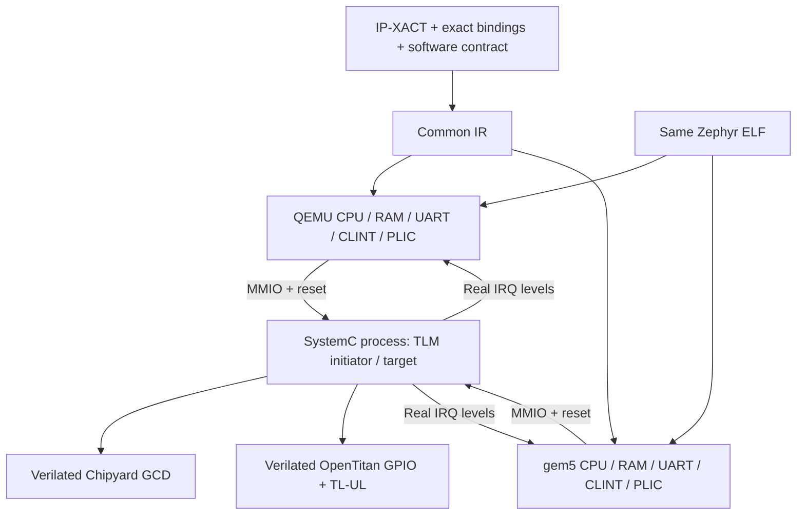

# One virtual SoC with Chipyard/OpenTitan IPs through SystemC

The executable contract is IP-XACT → one hardware IR → engine-specific CPU/board
adapters → shared SystemC/TLM RTL peripherals → one unchanged Zephyr ELF.
QEMU or gem5 owns CPU/RAM for a run. Both Chipyard GCD and OpenTitan GPIO coexist
in that running guest. These are actual RTL models, not host algorithms.



The two CPU boxes are alternatives tested in separate executions. Each execution
owns one SystemC process containing both RTL peripherals. The shared socket and
register/reset/IRQ contracts are described in examples/rv64-ips.md.

| Role | QEMU implementation | gem5 implementation |
|---|---|---|
| CPU / RAM | Generated usp-rv64, RV64 hart and RAM | RiscvTimingSimpleCPU, SimpleMemory |
| ROM | Generated QEMU reset stub | Original RV64 reset trampoline, read-only SimpleMemory |
| UART | QEMU serial_mm 16550 adapter | RiscvUart8250 + file terminal |
| CLINT / PLIC | QEMU ACLINT/PLIC | gem5 Clint/RTC/Plic |
| Finisher | SiFive test device | Original UspBridge signature/exit adapter |
| Chipyard GCD | SystemC/TLM → actual generated RTL | Same native binary and MMIO/IRQ contract |
| OpenTitan GPIO | SystemC/TLM → actual GPIO/TL-UL RTL | Same native binary and MMIO/IRQ contract |

GCD uses the project's MMIO/completion-IRQ shim, not a full Chipyard Diplomacy
system. GPIO uses actual TL-UL handshakes, integrity and backpressure checks.
All nine roles require exact supported VLNVs. The gem5 adapter lowers addresses,
PLIC sources, reset entry and timer frequency from that same validated IR.
The emitted engine-bindings.json records each role's actual owner/source/model.
Unknown IPs or unsupported profiles fail; XML alone cannot implement new behavior.

Gem5 boots through a real original RV64 ROM trampoline at the IR reset address,
passes mhartid in a0 and zero in a1, then enters the ELF in RAM. QEMU's stub also
provides a generated FDT pointer. This Zephyr application uses its compiled board
DTS and does not depend on a runtime FDT. No boot-ROM binary equivalence is claimed.

## Build and select an engine

Prepare QEMU/Zephyr and Chipyard/OpenTitan artifacts as in examples/rv64-ips.md.
Activate the frozen Python extras and native/SystemC tools. The clean gem5 source
is v24.1.0.3, b9da2bfe1e21f6efa2730edd4e80e58c5d965458.

```bash
source .venv/bin/activate
source /path/to/native-tools/env_bringup.sh
usp unified plan examples/rv64-ips --engine gem5
usp unified build-gem5 --source /path/to/gem5 --out build/unified-gem5 --jobs 2
usp unified run examples/rv64-ips --engine qemu \
  --generated build/rv64-ips --models build/source-ip-models --out results/unified-qemu-001
usp unified run examples/rv64-ips --engine gem5 \
  --generated build/rv64-ips --models build/source-ip-models \
  --bridge build/unified-gem5 --out results/unified-gem5-001
usp unified accept examples/rv64-ips --generated build/rv64-ips \
  --models build/source-ip-models --bridge build/unified-gem5 --out results/unified-001
usp unified verify results/unified-001
```

Use fresh output directories. The build uses gem5's supported out-of-tree EXTRAS
mechanism, preserving the existing SE binary even on failure. Upstream stays clean.
The separate extension executable/source hashes are verified before execution.
Existing gem5 objects can be reused; a cold build requires substantial resources.

The commands also accept systems/AI_SOC/bringup and systems/AIZ_SOC/bringup with
their corresponding generated build/AI_SOC and build/AIZ_SOC. Larger architecture
inventories and CPU-owned RTL/GDS test chips remain separate contracts.

## Acceptance and timing boundary

Both guests must boot the same ELF and handle timer/UART/PLIC interrupts. Actual
GCD vectors produce 6, 6, 255 and 1, consumed in a guest ISR. Actual GPIO loopback
raises its RTL interrupt, and the guest ISR clears INTR_STATE by W1C. Both guests
and owned model processes must exit successfully. ELF/IR/model hashes and ordered
IP commands/data must match across engines, excluding GCD status polling and time.
Raw UART/model/transaction logs, gem5 statistics, ELF, IR, bindings and source/build
identities are retained. Portable verification rejects changed evidence and false
full-architecture claims. Hashes detect changes; they are not digital signatures.

The mandatory local gate is tests/test_unified.py with USP_REQUIRE_UNIFIED=1,
USP_UNIFIED_GEM5_BUILD, USP_IP_MODELS_DIR, USP_IP_GENERATED_DIR and
USP_DUAL_BUILD_ROOT. It executes three profiles and a real short gem5 limit failure.

RTL advances only at transaction boundaries; status polls advance GCD. SystemC
annotates actual RTL cycles at 10 ns each, while gem5 PIO uses an uncalibrated
100 ns latency. Neither establishes CPU-cycle correlation or silicon performance.
This is functional system integration, not timing equivalence.

Asynchronous RTL scheduling, DMA/shared RAM, coherence, checkpoint restore and live
Garnet coupling remain unsupported. Full Rocket/Earlgrey and arbitrary-IP adapters
remain separate work. This gem5 path executes Zephyr/M-mode full-system MMIO, not
the earlier Linux-ABI SE workload; Linux on this bridge is unverified. UART/CLINT/
PLIC remain engine-native. Ibex, OpenTitan UART and rv_timer in the separate RTL
test-chip profiles have not yet been bound through this SystemC bridge.

The manual unified-soc workflow targets a trusted provisioned soc-eda runner.
Its USP_TOOLCHAIN_ENV must activate matching native QEMU/Zephyr/model artifacts
for all three profiles and set USP_GEM5_SOURCE. It builds the extension and runs
the native gate; it does not provision that runner. Hosted success is unobserved.

Observed acceptance on 2026-11-12 passed rv64-ips and both system bring-up maps.
Portable verified bundles are results/unified-rv64-ips-verified,
results/unified-AI_SOC-verified and results/unified-AIZ_SOC-verified. Both engines
recorded 172 RTL transactions per profile with matching command/data sequences.
The complete local regression passed 234 tests without skips; an independently
installed wheel also executed and verified the actual two-engine acceptance.
