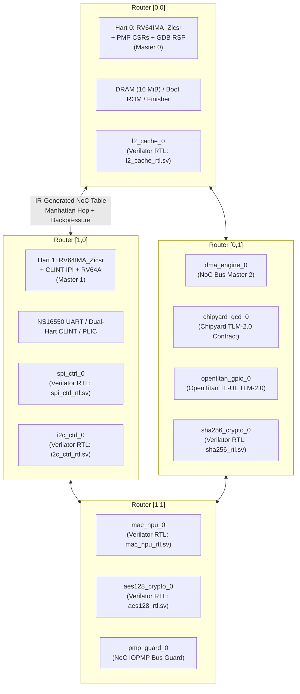

# Single Unified Multi-Platform SystemC/TLM-2.0 + Verilator RTL SoC Emulator

| Metadata Field | Value |
|---|---|
| **Document ID** | `SOCSIM-USOC-001` |
| **Current Version** | `0.3.0a5` (`E1–E12` Enterprise Baseline) |
| **Status** | Active / CI-Verified (`Podman SDK and OCI release` — 100% Real SystemC 3.0.1 + Verilator 5.032) |
| **Normative Authority** | `src/socsim/unified_systemc_soc.py`, `specs/multiplatform/unified_hetero_soc.yaml`, `specs/multiplatform/unified_systemc/` |

---

## Document Revision History

| Version | Release Date | Milestone / Gate | Author / Scope | Detailed Summary of Changes |
|---|---|---|---|---|
| `0.3.0a5-E1` | `2026-11-22` | `PR #1` (`df563f6`) | Unified SystemC Core | Merged QEMU IO, Chipyard GCD, OpenTitan GPIO, DMA Master, Verilator `mac_npu_rtl.sv`, IOPMP Guard, and GDB RSP into one `sc_main` 2×2 NoC binary; enforced `USP_REQUIRE_SYSTEMC=1`. |
| `0.3.0a5-E5` | `2026-11-23` | `PR #2` (`687c179`) | 4× RTL, VCD & Coverage | Added Verilator `sha256_rtl.sv`, `spi_ctrl_rtl.sv`, `l2_cache_rtl.sv`, IEEE 1364 VCD dump, 20-bin functional coverage, Process/Ray DSE cluster, and HTML5 dashboard. |
| `0.3.0a5-E9` | `2026-11-23` | `PR #3` (`911b450`) | SMP, 6× RTL & CHIA Loop | Added Dual-Hart SMP `RV64IMA_Zicsr` + CLINT IPI + RV64A atomics, Verilator `aes128_rtl.sv` & `i2c_ctrl_rtl.sv` (6× RTL), IR-generated NoC routing table (`unified_soc_routes.h`) + backpressure, 24-bin coverage, CHIA cyclic loop (`chia_loop.py`), and `usp ip scaffold`. |

---

## 1. Architecture & 2×2 Mesh NoC Topology

This emulator merges all heterogeneous platform domains into **one unified address map, one PLIC interrupt domain, and one single compiled SystemC 3.0.1 + Verilator 5.032 binary** executing real cross-compiled RISC-V64 bare-metal SMP firmware (`unified_sw.elf`).



---

## 2. Dual-Layer Traceability Matrix (IP Platform Origin vs. Execution Engine)

| Router | Instance Name | Hardware IP Platform / Contract | Execution Engine & Source Binding | Base Address | PLIC IRQ |
|---|---|---|---|---|---|
| `[0, 0]` | `unified_rv64_hart0` | RISC-V `RV64IMA_Zicsr` + PMP + GDB RSP | SystemC TLM-2.0 Initiator (Master 0) | `0x8000_0000` | — |
| `[0, 0]` | `main_dram`, `boot_rom`, `sim_finisher` | QEMU-compatible Memory / Finisher | SystemC TLM-2.0 Target (`sc_main.cpp`) | `0x8000_0000`, `0x0000_1000`, `0x0010_0000` | — |
| `[0, 0]` | `l2_cache_0` | Clean-room 64-line L2 + Snoop | **Verilator 5.032 SV RTL** (`rtl/l2_cache_rtl.sv`) | `0x1A00_0000` | — |
| `[1, 0]` | `unified_rv64_hart1` | RISC-V SMP `RV64IMA_Zicsr` + CLINT IPI | SystemC TLM-2.0 Initiator (Master 1) | `0x8000_0000` | — |
| `[1, 0]` | `qemu_uart_0`, `sys_clint`, `sys_plic` | QEMU-compatible NS16550 / CLINT / PLIC | SystemC TLM-2.0 Target | `0x1100_0000`, `0x0200_0000`, `0x0C00_0000` | `10` |
| `[1, 0]` | `spi_ctrl_0` | Clean-room 32-bit SPI Master | **Verilator 5.032 SV RTL** (`rtl/spi_ctrl_rtl.sv`) | `0x1900_0000` | `16` |
| `[1, 0]` | `i2c_ctrl_0` | Clean-room I2C Master/Slave FSM | **Verilator 5.032 SV RTL** (`rtl/i2c_ctrl_rtl.sv`) | `0x1C00_0000` | `18` |
| `[0, 1]` | `chipyard_gcd_0` | Chipyard GCD MMIO Contract | SystemC TLM-2.0 Contract (`chipyard.gcd`) | `0x1300_0000` | `12` |
| `[0, 1]` | `opentitan_gpio_0` | OpenTitan TL-UL GPIO Contract | SystemC TLM-2.0 Contract (`opentitan.gpio`) | `0x1400_0000` | `13` |
| `[0, 1]` | `dma_engine_0` | Memory-to-Memory DMA Engine | SystemC TLM-2.0 3rd Master (Master 2) | `0x1700_0000` | `14` |
| `[0, 1]` | `sha256_crypto_0` | Clean-room FIPS 180-4 64-round SHA-256 | **Verilator 5.032 SV RTL** (`rtl/sha256_rtl.sv`) | `0x1800_0000` | `15` |
| `[1, 1]` | `mac_npu_0` | Clean-room MAC + 2×2 MatMul NPU | **Verilator 5.032 SV RTL** (`rtl/mac_npu_rtl.sv`) | `0x1500_0000` | `20` |
| `[1, 1]` | `aes128_crypto_0` | Clean-room FIPS 197 10-round AES-128 | **Verilator 5.032 SV RTL** (`rtl/aes128_rtl.sv`) | `0x1B00_0000` | `17` |
| `[1, 1]` | `pmp_guard_0` | NoC IOPMP Access Policy Guard | SystemC TLM-2.0 Bus Guard (CPU & DMA) | `0x1600_0000` | `21` |

---

## 3. White-Box Execution Walkthrough

1. **Spec & IR Routing Header Synthesis** ([`unified_systemc_soc.py`](../src/socsim/unified_systemc_soc.py)):
   - Parses `specs/multiplatform/unified_hetero_soc.yaml`, validates address non-overlap, and emits `unified_soc_routes.h` defining exact `(base, size, router_x, router_y)` entries consumed directly by `NoC2x2Router` in C++.
2. **Verilation & Single-Binary Link**:
   - Invokes `verilator --cc` on all 6 SystemVerilog RTL blocks (`rtl/*.sv`) and links their generated C++ models with `sc_main.cpp` against `libsystemc` (SystemC 3.0.1, C++17).
3. **SMP Bare-Metal Firmware Compilation & Execution**:
   - Cross-compiles `firmware/unified_sw.c` with `riscv64-unknown-elf-gcc` into `unified_sw.elf`.
   - Hart 0 wakes Hart 1 via CLINT MSIP IPI; both harts execute RV64A atomics (`amoadd.w`), drive all 6 Verilator RTL accelerators + DMA + IOPMP + Chipyard GCD + OpenTitan GPIO, verify FIPS 180-4 SHA-256 (`"abc"`) and FIPS 197 AES-128 test vectors, and terminate via `sim_finisher`.
4. **Evidence Capture**:
   - Produces `report.json`, `console.log`, `unified-soc.vcd` (IEEE 1364 waveform), `coverage.json` (24/24 functional bins), and `noc_trace.jsonl`.

---

## 4. Reproducible Commands & Verified CI Output

```bash
# 1. Build & run Dual-Hart SMP + 6x Verilator RTL + IR NoC + VCD + 24-bin coverage + GDB RSP
usp unified-soc run specs/multiplatform/unified_hetero_soc.yaml --out results/unified-soc

# 2. Run 6x RTL-vs-TLM parity & cycle calibration on the exact same SMP RV64 ELF
usp unified-soc calibrate specs/multiplatform/unified_hetero_soc.yaml --out results/unified-cal

# 3. Scaffold a new IEEE 1685-2022 + SV RTL + SystemC TLM-2.0 IP plugin & publish to registry
usp ip scaffold xor_accel --out results/xor_accel
usp registry publish results/xor_accel/package.yaml --registry results/reg --version 1.0.0
usp registry verify --registry results/reg

# 4. Run CHIA-style multi-core/Ray parallel DSE sweep & cyclic optimization loop (isolated oracle)
usp dse sweep specs/multiplatform/unified_hetero_soc.yaml --out results/dse --workers 2 --cluster process --cache results/dse-cache
usp loop run specs/multiplatform/unified_hetero_soc.yaml --out results/chia-loop --max-iters 4 --cache results/loop-cache

# 5. Render zero-CDN air-gapped HTML5 Verification, Coverage, DSE & CHIA Convergence Dashboard
usp dashboard generate --out results/dashboard.html \
  --unified results/unified-soc/report.json \
  --calibration results/unified-cal/calibration.json \
  --dse results/dse/dse-report.json \
  --loop results/chia-loop/loop-report.json
```

Verified UART output captured from `Podman SDK and OCI release` (`911b450`):

```text
[UNIFIED-SOC] SMP Dual-Hart RV64IMA_Zicsr + 6x Verilator RTL + IR NoC PASS
[SMP] Hart1 IPI wakeup + RV64A atomic counter = 2 (PASS)
[RTL] MAC_NPU=PASS SHA256_FIPS180_4=PASS AES128_FIPS197=PASS SPI=PASS I2C=PASS L2_CACHE=PASS
[COV] 24/24 functional coverage bins hit (100.0%)
```

---

## 5. Honest Fidelity Disclosure

- In `verilator-rtl` mode (`fidelity: hybrid-systemc-tlm2-smp-and-6x-verilator-rtl-annotated-noc`), `mac_npu_0`, `sha256_crypto_0`, `aes128_crypto_0`, `spi_ctrl_0`, `i2c_ctrl_0`, and `l2_cache_0` execute real Verilator-compiled **clean-room** SystemVerilog RTL cycle-by-cycle inside SystemC 3.0.1 alongside Dual-Hart SMP `RV64IMA_Zicsr` cores, an IR-generated NoC routing table (`unified_soc_routes.h`), IEEE 1364 VCD waveform dump (`unified-soc.vcd`), and 24-bin functional coverage (`coverage.json`).
- The CPU, NoC router, Chipyard GCD, OpenTitan GPIO, DMA, and IOPMP models in this unified binary remain SystemC TLM-2.0 behavioral models—explicitly distinct from Verilated upstream Chipyard Rocket/Gemmini RTL, full OpenTitan EarlGrey silicon RTL, or live gem5 Garnet.
