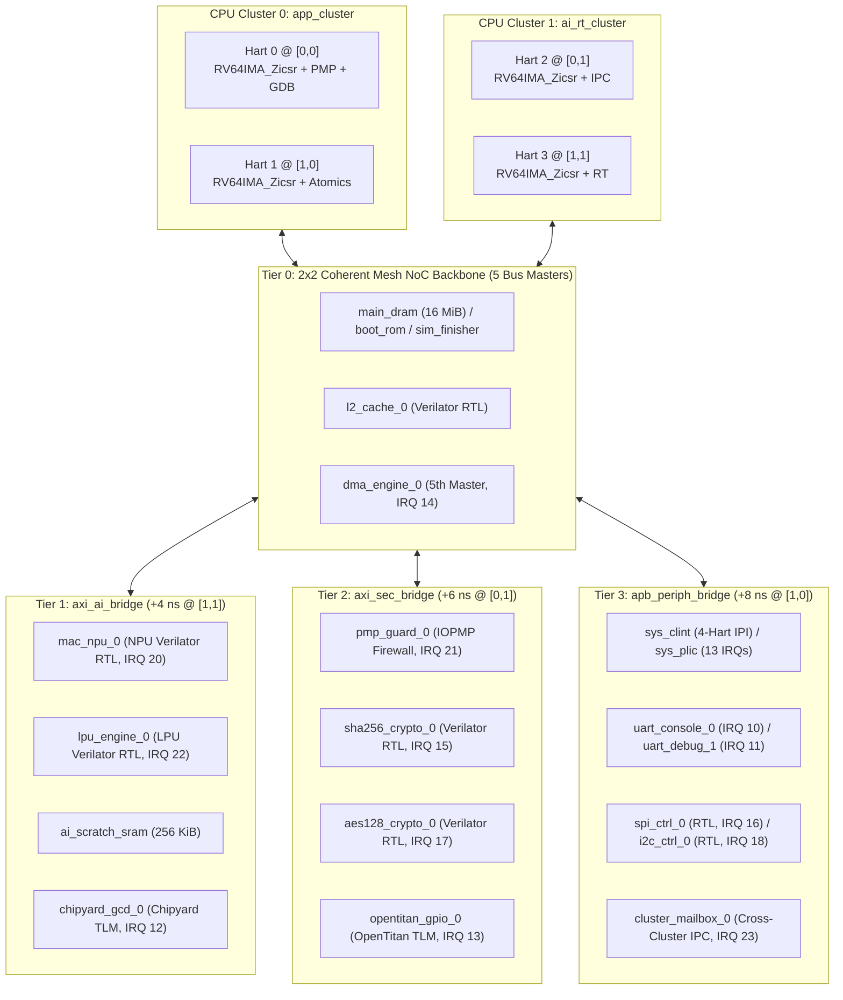

# ASoC — Multi-Cluster AI & Language SoC Official Example

| Metadata Field | Value |
|---|---|
| **Document ID** | `SOCSIM-EX-ASOC-001` |
| **Current Version** | `0.3.0a5` |
| **Status** | Active / Official Reference Example (`examples/ASoC`) |
| **Normative Authority** | `examples/ASoC/asoc_unified.yaml`, `examples/ASoC/asoc_fabric.yaml`, `examples/ASoC/asoc_flow.yaml`, `tests/test_asoc_example.py` |

---

## Document Revision History

| Version | Release Date | Milestone / Gate | Author / Scope | Detailed Summary of Changes |
|---|---|---|---|---|
| `0.3.0a5` | `2026-11-23` | Official `ASoC` Example | SoC Architecture & Verification | Added brand-new 20-IP, 2-CPU-cluster (4-hart), 4-tier hierarchical bus + 3-bridge SoC with Verilator NPU + LPU (`lpu_rtl.sv`), Dual-Layer PMP/IOPMP, Cross-Cluster Mailbox, AI Scratchpad SRAM, IEEE 1685-2022 fabric spec, and 30-bin coverage verification. |

---

## 1. Executive Architecture Summary

**ASoC** is an official, complex heterogeneous RISC-V64 SoC reference example designed to exercise the full capability stack of `socsim-platform` (`usp`):

- **Multi-Cluster Compute (2 CPU Clusters / 4 RV64IMA_Zicsr Harts + 5th DMA Bus Master):**
  - **Cluster 0 (`app_cluster`)**: `hart0` @ Router `[0, 0]` (Supervisor, PMP/Security & Job Dispatch, GDB RSP) + `hart1` @ Router `[1, 0]` (Application Compute Worker).
  - **Cluster 1 (`ai_rt_cluster`)**: `hart2` @ Router `[0, 1]` (AI/LPU Control & Mailbox Worker) + `hart3` @ Router `[1, 1]` (Real-Time Telemetry & Coherency Worker).
- **Complex 4-Tier Hierarchical Interconnect:**
  - **Tier 0 (`noc_backbone`)**: 2×2 Coherent Mesh NoC (`10 ns/hop + 5 ns link`, backpressure stalls, IR-generated `unified_soc_routes.h`).
  - **Tier 1 (`axi_ai_bridge`, `+4 ns`)**: High-bandwidth AXI4-256b AI Compute Bus hosting **NPU**, **LPU**, **256 KiB AI Scratchpad SRAM**, and **Chipyard GCD**.
  - **Tier 2 (`axi_sec_bridge`, `+6 ns`)**: Isolated AXI4-Lite Root-of-Trust & Security Bus hosting **IOPMP Bus Firewall (`pmp_guard_0`)**, **FIPS 180-4 SHA-256**, **FIPS 197 AES-128**, and **OpenTitan GPIO**.
  - **Tier 3 (`apb_periph_bridge`, `+8 ns`)**: Low-speed APB4/TL-UL Peripheral Bus hosting **4-Hart CLINT**, **System PLIC**, **Primary & Debug UARTs**, **SPI**, **I2C**, and **Cross-Cluster Hardware Mailbox**.
- **20 Mapped IPs** including **7 live Verilator 5.032 clean-room SystemVerilog RTL blocks** (`mac_npu_rtl.sv`, `lpu_rtl.sv`, `sha256_rtl.sv`, `aes128_rtl.sv`, `spi_ctrl_rtl.sv`, `i2c_ctrl_rtl.sv`, `l2_cache_rtl.sv`) + **Dual-Layer PMP** (CPU RISC-V PMP CSRs + NoC IOPMP Bus Guard).



---

## 2. Complete 20-IP Address Map, Bus Hierarchy & Dual-Layer Traceability

| # | IP Instance | Bus Domain / Bridge | Router | Base Address | Size | PLIC IRQ | Execution Engine & Binding |
|---:|---|---|---|---:|---:|---:|---|
| 1 | `boot_rom` | `noc_backbone` | `[0,0]` | `0x0000_1000` | `4 KiB` | — | SystemC TLM-2.0 ROM |
| 2 | `sim_finisher` | `noc_backbone` | `[0,0]` | `0x0010_0000` | `4 KiB` | — | SystemC TLM-2.0 SiFive Finisher |
| 3 | `main_dram` | `noc_backbone` | `[0,0]` | `0x8000_0000` | `16 MiB` | — | SystemC TLM-2.0 Coherent DRAM |
| 4 | `l2_cache_0` | `noc_backbone` | `[0,0]` | `0x1A00_0000` | `4 KiB` | — | **Verilator 5.032 SV RTL** (`l2_cache_rtl.sv`) |
| 5 | `dma_engine_0` | `noc_backbone` | `[0,1]` | `0x1700_0000` | `4 KiB` | `14` | SystemC TLM-2.0 5th Bus Master DMA |
| 6 | `mac_npu_0` | `axi_ai_bridge` (`+4 ns`) | `[1,1]` | `0x1500_0000` | `4 KiB` | `20` | **Verilator 5.032 SV RTL** (`mac_npu_rtl.sv`) |
| 7 | `lpu_engine_0` | `axi_ai_bridge` (`+4 ns`) | `[1,1]` | `0x1D00_0000` | `4 KiB` | `22` | **Verilator 5.032 SV RTL** (`lpu_rtl.sv`) |
| 8 | `ai_scratch_sram` | `axi_ai_bridge` (`+4 ns`) | `[1,1]` | `0x8100_0000` | `256 KiB` | — | SystemC TLM-2.0 AI/LPU Scratchpad SRAM |
| 9 | `chipyard_gcd_0` | `axi_ai_bridge` (`+4 ns`) | `[1,1]` | `0x1300_0000` | `4 KiB` | `12` | Chipyard GCD TLM-2.0 Contract |
| 10 | `pmp_guard_0` | `axi_sec_bridge` (`+6 ns`) | `[0,1]` | `0x1600_0000` | `4 KiB` | `21` | SystemC TLM-2.0 IOPMP Bus Firewall |
| 11 | `sha256_crypto_0` | `axi_sec_bridge` (`+6 ns`) | `[0,1]` | `0x1800_0000` | `4 KiB` | `15` | **Verilator 5.032 SV RTL** (`sha256_rtl.sv`) |
| 12 | `aes128_crypto_0` | `axi_sec_bridge` (`+6 ns`) | `[0,1]` | `0x1B00_0000` | `4 KiB` | `17` | **Verilator 5.032 SV RTL** (`aes128_rtl.sv`) |
| 13 | `opentitan_gpio_0` | `axi_sec_bridge` (`+6 ns`) | `[0,1]` | `0x1400_0000` | `4 KiB` | `13` | OpenTitan TL-UL GPIO TLM-2.0 Contract |
| 14 | `sys_clint` | `apb_periph_bridge` (`+8 ns`) | `[1,0]` | `0x0200_0000` | `64 KiB` | — | SystemC TLM-2.0 4-Hart CLINT (`msip[0..3]`) |
| 15 | `sys_plic` | `apb_periph_bridge` (`+8 ns`) | `[1,0]` | `0x0C00_0000` | `64 MiB` | — | SystemC TLM-2.0 System PLIC |
| 16 | `uart_console_0` | `apb_periph_bridge` (`+8 ns`) | `[1,0]` | `0x1100_0000` | `4 KiB` | `10` | SystemC TLM-2.0 Primary NS16550 UART |
| 17 | `uart_debug_1` | `apb_periph_bridge` (`+8 ns`) | `[1,0]` | `0x1100_1000` | `4 KiB` | `11` | SystemC TLM-2.0 Secondary Telemetry UART |
| 18 | `spi_ctrl_0` | `apb_periph_bridge` (`+8 ns`) | `[1,0]` | `0x1900_0000` | `4 KiB` | `16` | **Verilator 5.032 SV RTL** (`spi_ctrl_rtl.sv`) |
| 19 | `i2c_ctrl_0` | `apb_periph_bridge` (`+8 ns`) | `[1,0]` | `0x1C00_0000` | `4 KiB` | `18` | **Verilator 5.032 SV RTL** (`i2c_ctrl_rtl.sv`) |
| 20 | `cluster_mailbox_0` | `apb_periph_bridge` (`+8 ns`) | `[1,0]` | `0x1E00_0000` | `4 KiB` | `23` | SystemC TLM-2.0 Cross-Cluster IPC Mailbox |

---

## 3. Reproducible End-to-End Commands

### 3.1 Live Multi-Cluster SystemC + 7× Verilator RTL Simulation & Reports (Podman SDK)

```bash
# 1. Validate & generate ASoC headers, IR routing table (20 routes, 4 bus tiers), and linker script
usp unified-soc plan examples/ASoC/asoc_unified.yaml --out results/asoc-plan

# 2. Compile & run ASoC live (2 clusters / 4 harts + 7x Verilator RTL + 30-bin coverage + VCD + GDB RSP)
bash scripts/podman.sh run usp unified-soc run examples/ASoC/asoc_unified.yaml --out results/asoc-run

# 3. Run 7x Verilator RTL vs pure SystemC-TLM bit-exact parity & cycle calibration
bash scripts/podman.sh run usp unified-soc calibrate examples/ASoC/asoc_unified.yaml --out results/asoc-cal

# 4. Run CHIA-style Parallel DSE Sweep & Cyclic NoC Optimization Loop on ASoC
bash scripts/podman.sh run usp dse sweep examples/ASoC/asoc_unified.yaml --out results/asoc-dse --workers 2 --cluster process
bash scripts/podman.sh run usp loop run examples/ASoC/asoc_unified.yaml --out results/asoc-loop --max-iters 4

# 5. Render self-contained HTML5 Verification, Coverage, Calibration, DSE & CHIA Convergence Dashboard
bash scripts/podman.sh run usp dashboard generate --out results/asoc-dashboard.html \
  --unified results/asoc-run/report.json \
  --calibration results/asoc-cal/calibration.json \
  --dse results/asoc-dse/dse-report.json \
  --loop results/asoc-loop/loop-report.json
```

### 3.2 Hierarchical Multi-Bridge IEEE 1685-2022 IP-XACT & Native Flow Generation

```bash
# Validate & lower 5-space / 4-bridge hierarchical address decoder into IEEE 1685-2022 XML + Native IR
usp soc validate examples/ASoC/asoc_fabric.yaml --input-format fabric
usp soc generate examples/ASoC/asoc_fabric.yaml --input-format fabric --engine both --out build/asoc-fabric
usp domains derive build/asoc-fabric/native-ir.json
usp flow preflight examples/ASoC/asoc_flow.yaml
```

---

## 4. Honest Fidelity & Scope Boundaries

- In `verilator-rtl` mode (`hybrid-systemc-tlm2-multicluster-smp-and-7x-verilator-rtl-annotated-noc`), the 7 hardware blocks (`mac_npu_0`, `lpu_engine_0`, `sha256_crypto_0`, `aes128_crypto_0`, `spi_ctrl_0`, `i2c_ctrl_0`, `l2_cache_0`) execute real Verilator-compiled **clean-room** synthesizable SystemVerilog RTL cycle-by-cycle inside SystemC 3.0.1.
- The 4 RV64IMA_Zicsr harts (across 2 clusters), 2×2 NoC + 3 hierarchical AXI/APB bridges, DMA master, IOPMP bus firewall, hardware mailbox, Chipyard GCD, and OpenTitan GPIO execute as SystemC/TLM-2.0 behavioral models—explicitly distinct from full upstream Chipyard Rocket/Gemmini silicon RTL, full OpenTitan EarlGrey RTL, or commercial cycle-accurate AXI5/CHI signoff models.
- Verified live simulation outputs captured from CI are tracked in [`docs/examples/ASoC.md`](../../docs/examples/ASoC.md).
