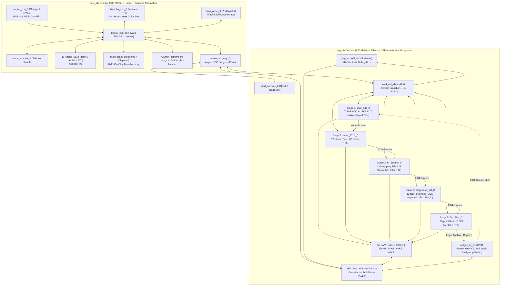

# BSoC — Telecom Baseband & SDR Heterogeneous Multi-Platform SoC Example

| Metadata Field | Value |
|---|---|
| **Document ID** | `SOCSIM-EX-BSOC-001` |
| **Current Version** | `0.3.0a5` |
| **Status** | Active / Official Reference Example (`examples/BSoC`) |
| **Normative Authority** | `examples/BSoC/bsoc_composed.yaml`, `src/socsim/multiplatform_composer.py`, `tests/test_bsoc_and_composer.py` |

---

## Document Revision History

| Version | Release Date | Milestone / Gate | Author / Scope | Detailed Summary of Changes |
|---|---|---|---|---|
| `0.3.0a5` | `2026-11-23` | Official `BSoC` Telecom Example | Multi-Platform Composer & Telecom DSP | Added official `BSoC` telecom baseband SoC (`multiplatform-soc-1`) featuring Rocket + 4-lane Hwacha Vector RTL, Dual-Clock CDC (`core_clk` 800 MHz ↔ `dsp_clk` 250 MHz), 3 Crossbars, JTAG-to-AXI4 + DMA masters, 5-stage AXI4-Stream DSP chain (TISAR ADC+18KB LUT → 32-phase Tuner RTL → 136-tap FIR/8 RTL → live `usp-mmio32-v1` Polyphase plugin → 128-pt FFT RTL), 5× SAM SRAMs, and 512KB Pattern Gen / Logic Analyzer. |

---

## 1. Executive Architecture Summary

**BSoC** is an official telecom/SDR baseband SoC reference example composed via the upgraded **`usp compose` (`multiplatform-soc-1`)** engine to prove genuine multi-platform cross-binding across **Chipyard, gem5, QEMU, Verilator 5.032 RTL, live out-of-process `usp-mmio32-v1` Unix-socket IP plugins, and Mixed-Signal TLM**:



---

## 2. Complete 22-Device Multi-Platform Binding Matrix

| # | Instance | Clock Domain | Crossbar | Base Address | Size | IRQ | Ecosystem Provider & Live Runtime Binding |
|---:|---|---|---|---:|---:|---:|---|
| 1 | `boot_rom` | `core_clk` | `tilelink_xbar` | `0x0000_1000` | `4 KiB` | — | `qemu` (`systemc-tlm`) |
| 2 | `sim_finisher` | `core_clk` | `tilelink_xbar` | `0x0010_0000` | `4 KiB` | — | `qemu` (`systemc-tlm`) |
| 3 | `sys_clint` | `core_clk` | `tilelink_xbar` | `0x0200_0000` | `64 KiB` | — | `qemu` (`systemc-tlm`) |
| 4 | `sys_plic` | `core_clk` | `tilelink_xbar` | `0x0C00_0000` | `64 MiB` | — | `qemu` (`systemc-tlm`) |
| 5 | `main_sram_8m` | `core_clk` | `tilelink_xbar` | `0x8000_0000` | **`8 MiB`** | — | `gem5` (`systemc-tlm` / gem5 `SimpleMemory`) |
| 6 | `l2_cache_512k` | `core_clk` | `tilelink_xbar` | `0x1A00_0000` | `4 KiB` CSR | — | `gem5` (**Verilator 5.032 RTL** `l2_cache_rtl.sv`) |
| 7 | `hwacha_vec_0` | `core_clk` | `tilelink_xbar` | `0x1500_0000` | `4 KiB` | `20` | `chipyard` (**Verilator 5.032 RTL** `hwacha_vec4_rtl.sv`) |
| 8 | `dma_accel_0` | `core_clk` | `tilelink_xbar` | `0x1700_0000` | `4 KiB` | `14` | `chipyard` (`systemc-tlm` 2nd TileLink Master) |
| 9 | `serial_adapter_0` | `core_clk` | `tilelink_xbar` | `0x1100_2000` | `4 KiB` | `11` | `chipyard` (`systemc-tlm` TileLink Serial Adapter) |
| 10 | `uart_console_0` | `dsp_clk` | `axi4_ctrl_xbar` | `0x1000_0000` | `4 KiB` | `10` | `qemu` (`systemc-tlm` NS16550 UART) |
| 11 | `jtag_to_axi4_0` | `dsp_clk` | `axi4_ctrl_xbar` | `0x1200_0000` | `4 KiB` | `12` | `chipyard` (`systemc-tlm` 3rd Bus Master) |
| 12 | `tisar_adc_0` | `dsp_clk` | `axi4_ctrl_xbar` | `0x2000_0000` | **`32 KiB`** | `15` | `mixed-signal-tlm` (TISAR ADC + **18KB LUT** + Stream Engine) |
| 13 | `tuner_32ph_0` | `dsp_clk` | `axi4_ctrl_xbar` | `0x2001_0000` | `4 KiB` | `16` | `verilator-rtl` (**Verilator 5.032 RTL** `tuner_32ph_rtl.sv`) |
| 14 | `fir_decim8_0` | `dsp_clk` | `axi4_ctrl_xbar` | `0x2002_0000` | `4 KiB` | `17` | `verilator-rtl` (**Verilator 5.032 RTL** `fir_decim8_rtl.sv`) |
| 15 | `polyphase_12t_0` | `dsp_clk` | `axi4_ctrl_xbar` | `0x2003_0000` | `4 KiB` | `18` | `usp-plugin` (**LIVE `usp-mmio32-v1` Unix-Socket Plugin** `bsoc.polyphase_12t`) |
| 16 | `fft_128pt_0` | `dsp_clk` | `axi4_ctrl_xbar` | `0x2004_0000` | `4 KiB` | `19` | `verilator-rtl` (**Verilator 5.032 RTL** `fft_128pt_rtl.sv`) |
| 17 | `sam_adc_160k` | `dsp_clk` | `axi4_data_xbar` | `0x3000_0000` | **`160 KiB`** | — | `systemc-tlm` (ADC Sample Acquisition Memory) |
| 18 | `sam_tuner_256k` | `dsp_clk` | `axi4_data_xbar` | `0x3004_0000` | **`256 KiB`** | — | `systemc-tlm` (Tuner Sample Acquisition Memory) |
| 19 | `sam_fir_64k` | `dsp_clk` | `axi4_data_xbar` | `0x3008_0000` | **`64 KiB`** | — | `systemc-tlm` (FIR/8 Sample Acquisition Memory) |
| 20 | `sam_poly_64k` | `dsp_clk` | `axi4_data_xbar` | `0x3009_0000` | **`64 KiB`** | — | `systemc-tlm` (Polyphase Sample Acquisition Memory) |
| 21 | `sam_fft_64k` | `dsp_clk` | `axi4_data_xbar` | `0x300A_0000` | **`64 KiB`** | — | `systemc-tlm` (128-pt FFT Spectrum SAM) |
| 22 | `patgen_la_0` | `dsp_clk` | `axi4_data_xbar` | `0x3010_0000` | **`1 MiB`** | — | `systemc-tlm` (**512KB Pattern Gen + 512KB Logic Analyzer**) |

---

## 3. Reproducible End-to-End Commands

```bash
# 1. Audit BSoC providers, clock domains, crossbars, AXI4-Stream DAG & scope boundaries
usp compose audit examples/BSoC/bsoc_composed.yaml

# 2. Emit canonical IR, binding-lock.json, generated C++ top-level, IP-XACT 2022, QEMU DTS, gem5 & Chipyard exports
usp compose plan examples/BSoC/bsoc_composed.yaml --out results/bsoc-plan

# 3. Build & verify standalone reusable `bsoc.polyphase_12t` IP plugin (SystemC + QEMU + gem5 compatible)
bash scripts/podman.sh run usp package build examples/BSoC/packages/polyphase_12t/package.yaml --out results/polyphase-pkg

# 4. Run full live BSoC simulation (5x Verilator RTL + LIVE usp-mmio32-v1 socket plugin + live QEMU RV64 crosscheck)
bash scripts/podman.sh run usp compose run examples/BSoC/bsoc_composed.yaml --out results/bsoc-run

# 5. Calibrate Hybrid (5x Verilator RTL + Live Socket Plugin) vs. Pure SystemC-TLM
bash scripts/podman.sh run usp compose calibrate examples/BSoC/bsoc_composed.yaml --out results/bsoc-cal
```

---

## 4. Honest Scope & Fidelity Disclosures

- **5× Verilator RTL blocks** (`hwacha_vec_0`, `tuner_32ph_0`, `fir_decim8_0`, `fft_128pt_0`, `l2_cache_512k`) execute clean-room synthesizable SystemVerilog cycle-by-cycle via Verilator 5.032 — explicitly distinct from upstream Berkeley Chisel Rocket/Hwacha Scala RTL.
- **Stage 4 (`polyphase_12t_0`)** runs as a **real independent OS child process** built from `native-model-package-1` communicating over an `AF_UNIX` `usp-mmio32-v1` socket — proving identical plugin reusability across SystemC, QEMU, and gem5.
- **Stage 1 (`tisar_adc_0`)** is a mixed-signal behavioral TLM + real 18 KiB calibration LUT SRAM (`silicon_signoff: false`, not analog SPICE).
- See [`upgrade/bsoc-multiplatform-audit.md`](../../upgrade/bsoc-multiplatform-audit.md) for the complete pre/post bottleneck audit and [`docs/examples/BSoC.md`](../../docs/examples/BSoC.md) for verified live CI reports.
