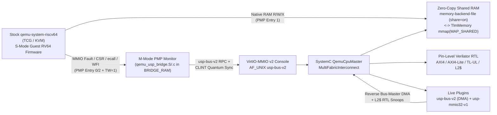

# USP Core Architecture Upgrades (v2): QEMU Direct CPU Master, `usp-bus-v2` Reverse-DMA/Burst/Quantum Protocol, and Automatic Pin-Level AXI4/TL-UL RTL Adapters

| Metadata Field | Value |
|---|---|
| **Document ID** | `SOCSIM-UPG-V2-001` |
| **Current Version** | `0.3.0a5` |
| **Status** | Active / Verified Architecture Record |
| **Normative Authority** | `src/socsim/multiplatform_composer.py`, `src/socsim/rtl_pin_adapter.py`, `src/socsim/resources/composer/usp_bus_protocol.hpp`, `src/socsim/resources/composer/composer_runtime.hpp`, `tests/test_usp_v2_upgrades.py` |

---

## Document Revision History

| Version | Release Date | Milestone / Gate | Author / Scope | Summary of Changes |
|---|---|---|---|---|
| `0.3.0a5` | `2026-11-24` | USP Core Upgrade Batch (3 Upgrades) | Multi-Platform Composer, Protocol & RTL Adapters | Implemented real QEMU (`qemu-system-riscv64` TCG/KVM) direct CPU master, `usp-bus-v2` protocol with reverse DMA/64-bit bursts/quantum sync & `usp-mmio32-v1` backward compatibility, and automatic pin-level AXI4/AXI4-Lite/OpenTitan TL-UL Verilator RTL adapters; validated with `examples/UspNextGen` and `BSoC --cpu-master qemu`. |

---

## 1. Executive Summary

Starting from `dev` (`0f77cb2`), USP (`multiplatform-soc-1`) has been upgraded across three structural axes that previously constrained scalability, plugin autonomy, and upstream RTL adoption:

| # | Upgrade Area | Previous Boundary (`0f77cb2`) | Upgraded Architecture (USP v2) |
|---|---|---|---|
| **1** | **CPU Master Engine** | Single-threaded C++ `Rv64CpuMaster` interpreter inside SystemC (~10–20 KIPS; practical limit ~800k instructions). | **Stock `qemu-system-riscv64` (TCG on x86_64/arm64; KVM on `riscv64` + `/dev/kvm`)** acting directly as CPU Master driving SystemC `MultiFabricInterconnect` + Verilator RTL over zero-copy `mmap(MAP_SHARED)` RAM and VirtIO-MMIO v2 `AF_UNIX` (`QemuCpuMaster`). |
| **2** | **Out-of-Process Plugin Protocol** | `usp-mmio32-v1`: 20-byte host-initiated 32-bit scalar MMIO only; no plugin-initiated DMA, no 64-bit bursts, no quantum time sync. | **`usp-bus-v2`** (48-byte header + optional up-to-4096B burst/DMA payload, magic `0x32425355` `"USB2"`) supporting **reverse bus-master DMA** (`USP_OP_DMA_READ`/`WRITE`), **64-bit multi-beat bursts** (`USP_OP_BURST_READ`/`WRITE`), and **quantum time sync** (`USP_OP_TIME_SYNC`) across QEMU ↔ SystemC ↔ gem5 (`NativeSocDevice`) while preserving **100% wire-level & runtime backward compatibility** with `usp-mmio32-v1` (`0x31505355`). |
| **3** | **Pin-Level Verilator RTL Loading** | Verilator RTL modules had to expose a custom 9-pin `req_valid_i/req_write_i/req_addr_i/req_wdata_i/rsp_rdata_o/rsp_err_o` MMIO32 wrapper. | **Automatic SV port introspection** (`src/socsim/rtl_pin_adapter.py`) + **cycle-accurate C++17 pin-level adapters** (`VerilatorAxi4FullAdapter`, `VerilatorAxi4LiteAdapter`, `VerilatorTlulAdapter`) directly binding Chipyard/`firtool` AXI4 64-bit, AMBA AXI4-Lite, and OpenTitan TL-UL (with deliberate D-channel `d_ready=0` backpressure verification) without manual MMIO32 wrapping. |

---

## 2. Architecture & Design Details

### 2.1 Upgrade 1 — Real QEMU Direct CPU Master (`QemuCpuMaster` + M-Mode PMP Monitor)

- **Zero Address-Map Conflict:** Three TOR PMP entries grant S-mode guest direct native `R|W|X` access exclusively to `[SOC_MAIN_RAM_BASE, SOC_MAIN_RAM_BASE + SOC_MAIN_RAM_SIZE)` while trapping all non-RAM addresses (including `0x20000000`, `0x30000000`, `0x40000000`) to M-mode. M-mode bypasses unlocked PMP entries to communicate with QEMU `virt`'s VirtIO-MMIO v2 Console, CLINT timer, and Test Finisher cleanly.
- **Unmodified Guest Compatibility:** M-mode CSRs (`mtvec`, `mstatus`, `mie`, `mepc`, `mcause`, `mtval`, `mhartid`), `mret`, and `wfi` (`MSTATUS.TW=1`) are virtualized cleanly, allowing unmodified bare-metal SoC firmwares such as `examples/BSoC/sw/bsoc_telecom_sw.c` (22 devices, 6 PLIC IRQs) to run directly on QEMU TCG via `--cpu-master qemu`.
- **Guest Hypercalls (`usp_bus_v2_guest.h`):** Optional `ecall` ABI (`a7 = 0x55535032`) exposes `usp_bus_burst_write64`, `usp_bus_burst_read64`, `usp_bus_time_sync`, and `usp_bus_poll_irq` with transparent fallback when executed on `Rv64CpuMaster`.
- **Honest Acceleration Policy:** `--qemu-accel auto` selects `kvm` only on `riscv64` hosts with usable `/dev/kvm`, and `tcg` elsewhere. Explicitly passing `--qemu-accel kvm` on non-`riscv64`/non-KVM hosts fails cleanly with `E_COMPOSE_QEMU_KVM` (never silently downgrading).

### 2.2 Upgrade 2 — `usp-bus-v2` Protocol & Backward Compatibility

- **Wire Specification (`src/socsim/resources/composer/usp_bus_protocol.hpp`):**
  - Legacy `usp-mmio32-v1`: 20 bytes, magic `0x31505355` (`"USP1"`). Unchanged.
  - Upgraded `usp-bus-v2`: 48-byte fixed little-endian `UspBusV2Frame`, magic `0x32425355` (`"USB2"`), optional payload up to `4096` bytes (`USP_FLAG_HAS_PAYLOAD`).
  - Opcodes: `READ (0)`, `WRITE (1)`, `RESET (2)`, `BURST_READ (3)`, `BURST_WRITE (4)`, `TIME_SYNC (5)`, `DMA_READ (0x10)`, `DMA_WRITE (0x11)`, `IRQ_NOTIFY (0x12)`, plus `USP_OP_RESPONSE (0x8000)`.
- **Full-Duplex Reverse Bus-Master DMA:** While servicing an MMIO command (e.g., `CTRL = 1`), an out-of-process plugin transmits `USP_OP_DMA_READ` / `USP_OP_DMA_WRITE` requests back over the same `AF_UNIX` socket. `UspBusV2ProxyTlm` (SystemC), `NativeSocDevice` (gem5 `physProxy`), and `bridge.c.in` (custom QEMU `address_space_rw`) pump and complete nested DMA requests directly against SoC/QEMU RAM (triggering Verilator `l2_cache_rtl` snoops!) before returning the outer MMIO response.
- **Quantum Time Sync Across Engines:** QEMU's M-mode CLINT timer fires every `quantum_ns`, sending `USP_OP_TIME_SYNC` with retired `minstret` to SystemC `QemuCpuMaster`, which advances SystemC time and propagates `USP_OP_TIME_SYNC` to all `UspBusV2ProxyTlm` peers. gem5 `NativeSocDevice` likewise schedules periodic `EventFunctionWrapper` quantum barriers at `curTick()` when `quantum_ns > 0`.

### 2.3 Upgrade 3 — Automatic Pin-Level Verilator RTL Adapters

- **Port Auto-Introspection (`src/socsim/rtl_pin_adapter.py`):** Parses SystemVerilog module port declarations and matches Chipyard/`firtool` (`io_axi_aw_bits_*`), standard AMBA (`s_axi_aw*` / `aw_*`), OpenTitan TL-UL (`tl_a_*_i` / `tl_d_*_o`), and legacy `mmio32` interfaces, inferring data width (32/64-bit), active-high vs. active-low reset, ID/source widths, and IRQ pins. Optional `rtl_port_map` overrides allow non-standard naming.
- **Cycle-Accurate Pin-Level Adapters (`composer_runtime.hpp`):**
  - `VerilatorAxi4FullAdapter<VDut, Traits>`: drives `aw/w/b/ar/r` valid-ready channels with real multi-beat INCR bursts (`awlen`/`arlen`, `awsize`/`arsize`, `wlast`/`rlast`), narrow-transfer byte-lane `wstrb` steering, and `SLVERR`/`DECERR` -> `TLM_ADDRESS_ERROR_RESPONSE` propagation.
  - `VerilatorAxi4LiteAdapter<VDut, Traits>`: drives independent `aw`/`w`/`b` and `ar`/`r` valid-ready handshakes with wait-state tolerance and `SLVERR` propagation.
  - `VerilatorTlulAdapter<VDut, Traits>`: drives OpenTitan `Get (4)` / `PutFullData (0)` / `PutPartialData (1)` on A-channel, asserts `d_ready = 0` for 1 full clock cycle after `d_valid` rises to verify D-channel backpressure stability, checks `d_source` parity, and maps `d_error` to `TLM_ADDRESS_ERROR_RESPONSE`.

---

## 3. Honest Architectural Boundaries

1. **QEMU TCG vs. KVM:** On x86_64/arm64 CI runners, `qemu-system-riscv64` runs under TCG dynamic binary translation (not KVM hardware virtualization, which requires a native `riscv64` host with `/dev/kvm`). Wall-time MIPS reported in `report.json` / `report.md` reflects host wall-clock emulation throughput, not cycle-accurate CPU pipeline IPC.
2. **Chisel/Scala Elaboration:** Automatic pin-level AXI4/TL-UL adapters load SystemVerilog directly without manual MMIO32 shims; elaborating Chisel Scala sources to SystemVerilog still requires `sbt`/`firtool` (`scripts/setup_chipyard.sh`).
3. **gem5 Live Execution:** `NativeSocDevice` (`native_soc_device.hh`/`.cc`, `NativeSocDevice.py.in`) and generated `gem5_system.py` scripts implement full `usp-bus-v2` DMA/burst/quantum support; live gem5 execution requires building `gem5.opt` via `scripts/setup_gem5.sh`.
